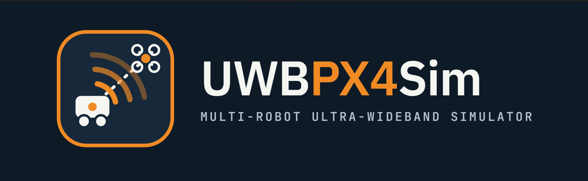
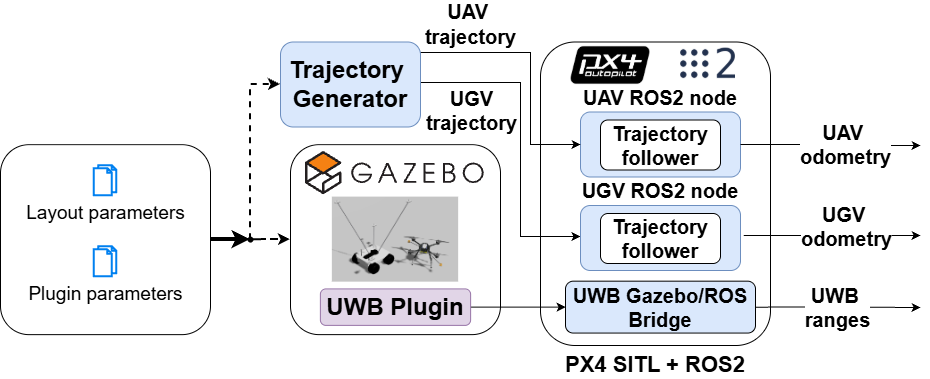
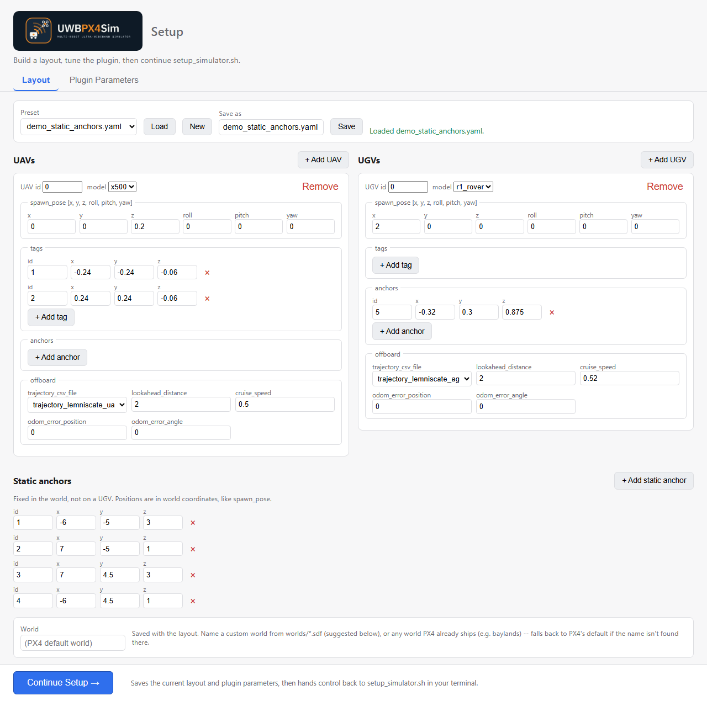

# UWBPX4Sim

:pushpin: This work has been presented at the [1st Workshop on Robot Meets GNSS and Ranging for Seamless Autonomy](https://robotmeetsranging.tech/) during ICRA 2026!

:pushpin: This work has been featured in the [ROSCon Spain 2026](https://roscon.org.es/roscon2026/ROSConES2026.html) official program!



A ready-to-use Ultra-Wideband simulator for relative localization of multi-robot teams integrated with ROS 2, Gazebo Harmonic and PX4 SITL. This is a standalone repo that is complementary to the work [Radio-based Multi-Robot Odometry and Relative Localization](https://github.com/amartinezsilva/mr-radio-localization?tab=readme-ov-file), containing all simulation-based tools used in the main work.



## Features

- **UWB measurement plugin** for Gazebo: two-way ranging (TWR) or time difference of arrival (TDOA), with noise, dropout and bias driven by distance and by the obstacles in the way, including their material. See [Measurement model](docs/measurement_model.md).
- **Calibrated presets**, one per system and mode: `eliko_twr` (Eliko, TWR), `lps_tdoa` (Bitcraze Loco Positioning, TDOA) and `lps_twr` (Bitcraze Loco Positioning, TWR). Tune one and save your own from the setup GUI.
- **Multi-robot layouts** from one YAML file: UAVs and UGVs carrying any mix of tags and anchors, plus anchors fixed in the world. Vehicle models and the ROS 2 bridge are generated from it.
- **Guided setup** with a browser GUI, a one-command **launcher**, and **RViz** showing the robots, transceivers and live UWB links for any layout.
- **ROS 2 offboard nodes** that fly the UAVs and drive the UGVs along CSV trajectories.

## Calibration datasets

Each preset is calibrated from a real UWB dataset (details and validation in [Measurement model: Calibration](docs/measurement_model.md#calibration)):

| Preset | Dataset | UWB system | Mode | Conditions |
| --- | --- | --- | --- | --- |
| `eliko_twr` | Eliko identification [1] | Eliko KIO RTLS | TWR | LOS |
| `lps_tdoa` | UTIL identification dataset [2] | Bitcraze Loco Positioning (DWM1000) | TDOA | LOS and NLOS |
| `lps_twr` | Pfeiffer et al. UWB dataset [3] | Bitcraze Loco Positioning (DWM1000) | TWR | LOS |

Pfeiffer et al.'s TDoA flights [3] were also used to test the Loco Positioning TDOA preset on a second installation.

1. A. Martínez-Silva, D. Alejo, L. Merino, F. Caballero, "Radio-based Multi-Robot Odometry and Relative Localization", 2025. [Paper](https://arxiv.org/abs/2509.26558), [data](https://dataverse.harvard.edu/dataset.xhtml?persistentId=doi:10.7910/DVN/KNKWMJ).
2. W. Zhao, A. Goudar, X. Qiao, A. P. Schoellig, "UTIL: An Ultra-wideband Time-difference-of-arrival Indoor Localization Dataset", *IJRR*, 2024. [Paper](https://arxiv.org/abs/2203.14471), [data](https://github.com/utiasDSL/util-uwb-dataset).
3. S. Pfeiffer, C. de Wagter, G. C. H. E. de Croon, "A Computationally Efficient Moving Horizon Estimator for Ultra-Wideband Localization on Small Quadrotors", *IEEE RA-L*, 2021. [Paper](https://doi.org/10.1109/LRA.2021.3095519), [data](https://doi.org/10.4121/14827680).

## Getting started

A `docker/` folder is provided with a ready-to-use image (Ubuntu 24.04, ROS 2 Jazzy, Gazebo Harmonic, PX4, and this repo's plugin/bridge pre-built) as an alternative to setting everything up natively. It requires [Docker](https://docs.docker.com/engine/install/) and the [Docker Compose plugin](https://docs.docker.com/compose/install/).

```bash
cd <ros_ws>/src
git clone --recurse-submodules https://github.com/amartinezsilva/UWBPX4Sim.git
cd UWBPX4Sim/docker
./setup.sh
```

The first build compiles the PX4 toolchain and the full ROS 2 workspace, so it can take a while (15-30 minutes depending on your machine); subsequent runs reuse the cached image and start instantly. `setup.sh` then starts a **persistent** container in the background and drops you into its guided menu:

1. **Run UWBPX4Sim setup** (`setup_simulator.sh`): configure the PX4/Gazebo plugin, models, and layout inside the container. Opens a browser-based GUI (prints the URL, default `http://localhost:5050`) to build the robot layout and tune plugin parameters, then shows setup's progress there, including the optional PX4 re-compile; falls back to terminal prompts if the GUI isn't available.
2. **Launch simulation** (ticks once setup has been run): launches PX4 SITL, Gazebo, and the UWB bridge/offboard nodes via `simulator_launcher.sh`.
3. **Open a shell**: skip the menu and get a plain shell in the container.
4. **Exit**: stops the container, and asks whether to remove it completely instead (default just stops it) -- everything else, including closing your terminal, leaves it running with your configuration intact. Run `./setup.sh` again any time to get back to this same menu.



`docker-compose.yml` bind-mounts the whole repository (plus `ROS2/px4_sim_offboard/trajectories/` onto its installed path) from the host into the container, so editing a layout, a plugin-parameter preset, a custom world, a trajectory CSV, or the plugin source on the host takes effect the next time setup (or the simulation) runs -- no image rebuild needed.

This image is also the base that [mr-radio-localization](https://github.com/amartinezsilva/mr-radio-localization)'s own Docker image builds `FROM`, adding its radar/localization stack on top -- see that repo's `docker/` for the layered setup.

To run without Docker, see [Running without Docker](docs/advanced_setup.md#running-without-docker).

## Configuring an experiment

A layout YAML in `config/` defines the robots, their spawn poses, the UWB sensors they carry and their trajectories:

```yaml
world: walls_nlos          # optional: a file from worlds/, or a world PX4 ships
uavs:
  - id: 0
    spawn_pose: [3.0, 0.0, 0.0, 0.0, 0.0, 1.57079632679]   # x, y, z, roll, pitch, yaw
    offboard:
      trajectory_csv_file: trajectory_lemniscate_uav.csv
    tags:
      - id: 1
        position: [-0.24, -0.24, -0.06]                    # relative to the robot
ugvs:
  - id: 0
    spawn_pose: [0.0, 0.0, 0.0, 0.0, 0.0, 1.57079632679]
    offboard:
      trajectory_csv_file: trajectory_lemniscate_agv.csv
    anchors:
      - id: 1
        position: [-0.32, 0.3, 0.875]
static_anchors:                                            # optional, not on a robot
  - id: 5
    position: [4.0, 2.0, 2.5]                              # in world coordinates
```

Any robot can carry `tags`, `anchors` or both. Tag ids must be unique across the layout, and so must anchor ids. `uavs` and `ugvs` are optional, as long as there is at least one tag and one anchor. See [`config/`](config/) for complete examples. Build layouts from the setup GUI or edit the files directly, then run setup again.

To mark an obstacle's material, add a `<uwb:material>` element to its model (or to one of its collisions), and declare the `uwb` prefix on the world's `<sdf>` root:

```xml
<sdf version="1.9" xmlns:uwb="https://github.com/amartinezsilva/UWBPX4Sim">
  ...
  <model name="wall_1">
    <uwb:material>concrete</uwb:material>
```

A `__material_<name>` suffix on the model name, e.g. `wall_1__material_concrete`, also still works. See the [measurement model](docs/measurement_model.md#link-geometry) for details.

## Output topics

| Mode | Measurements | Ground truth |
| --- | --- | --- |
| TWR | `/uwb_gz_simulator/distances/aItJ` | `/uwb_gz_simulator/distances_ground_truth/aItJ` |
| TDOA | `/uwb_gz_simulator/tdoa/aIaKtJ` | `/uwb_gz_simulator/tdoa_ground_truth/aIaKtJ` |

`I` and `K` are anchor ids (`I` is the TDOA reference, the lowest anchor id) and `J` is the tag id. All of these topics are bridged to ROS 2, but only the active mode publishes. Each robot also publishes `/<prefix>/odom` and `/<prefix>/gt`, with prefix `uav_<id>` or `ugv_<id>`.

## Using the plugin on its own

The Gazebo plugin also works without PX4 or ROS 2, in your own Gazebo Harmonic world with your own robots. See [`examples/barebones/`](examples/barebones/).

## Documentation

- [UWB basics](docs/uwb_basics.md): a short introduction to UWB ranging, TWR and TDoA, and common setups, for readers new to UWB.
- [Measurement model](docs/measurement_model.md): equations, materials, all plugin parameters and calibration results.
- [Advanced setup](docs/advanced_setup.md): running without Docker, full layout reference, adding vehicle types, manual installation and ROS 2 interfaces.
