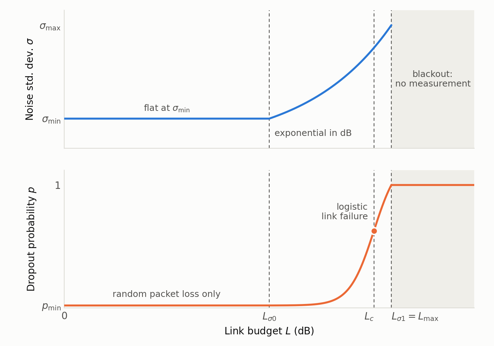
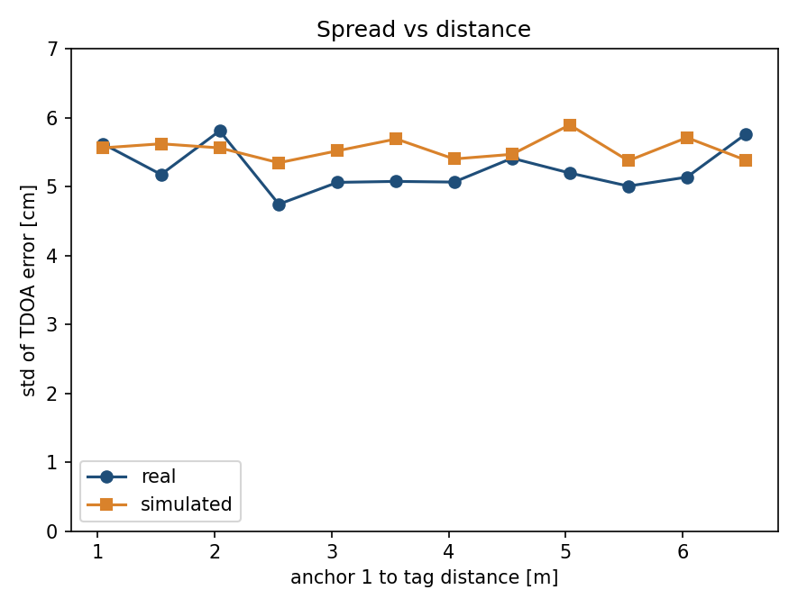
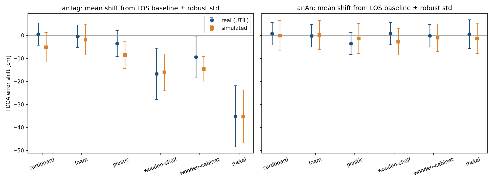
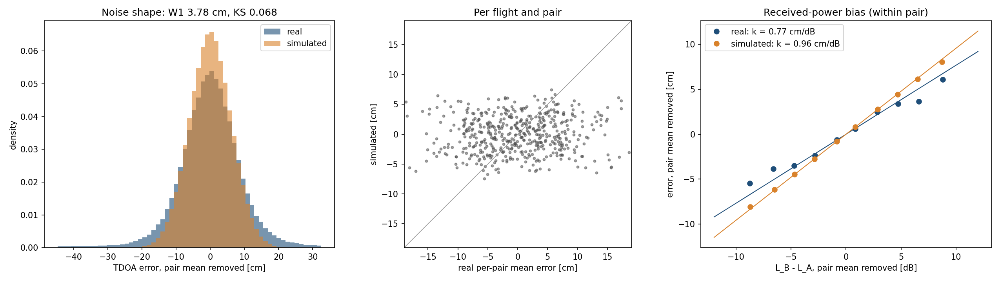
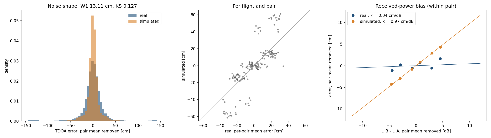
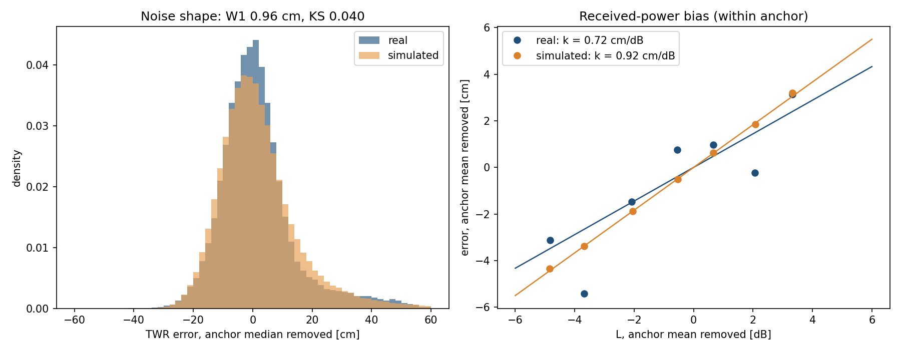

# Measurement model

New to UWB? Start with [UWB basics](uwb_basics.md), which explains ranging, TWR and TDoA, and the usual setups.

The `UWBGazeboPlugin` system simulates UWB measurements between anchors and tags with a **link budget**. At every update (`update_rate_hz`, 10 Hz by default) it computes, for each tag-anchor link, the excess loss $`L`$ (in dB) from free-space path loss plus every obstacle the line of sight crosses; $`L`$ sets the noise standard deviation $`\sigma`$ and the dropout probability $`p`$. It then publishes a ground truth and a simulated measurement: one link per TWR range, two links per TDOA value. Because distance and obstacles add up in the same dB budget, their relative influence follows from physical magnitudes: doubling the distance costs 6 dB, a 25 cm interior wall about 8 dB, and a 20 cm concrete wall about 20 dB (at 4 GHz).

Parameters are introduced below as `code` next to the symbol they set; all of them are listed in [Parameter reference](#parameter-reference). They live in a preset under `uwb_gazebo_plugin/presets/` (a plain `key: value` file; keys left out use the compiled-in defaults), which `./setup_simulator.sh` syncs into the plugin's block in PX4's `server.config` on every run -- pick one with `--params <name>`, in the setup GUI's "Plugin Parameters" tab, or from the terminal picker. The three shipped presets, `eliko_identification` (Eliko TWR, the default under `-y`), `util_identification` (calibrated from the [UTIL](https://utiasdsl.github.io/util-uwb-dataset/) TDOA dataset) and `lps_twr_identification` (calibrated from Bitcraze Loco Positioning TWR flights [Pfeiffer et al.]; see [Calibration](#calibration)), are read-only from the GUI: tune one and save it under a new name.

## Ranging modes and topics

`uwb_mode` selects the ranging scheme for the whole simulation:

- **`twr`** (default) -- one range per anchor-tag pair, published on `<topic>/aItJ` and `<ground_truth_topic>/aItJ` (anchor `I`, tag `J`; defaults `/uwb_gz_simulator/distances[_ground_truth]`). The offboard nodes re-package them into `eliko_messages/DistancesList`, the same format as the real Eliko driver.
- **`tdoa`** -- one difference of distances per anchor against a reference anchor (downlink TDoA, as in Bitcraze's Loco Positioning System), published on `<tdoa_topic>/aIaKtJ` and `<tdoa_ground_truth_topic>/aIaKtJ` (reference `I`, anchor `K`, tag `J`; defaults `/uwb_gz_simulator/tdoa[_ground_truth]`). There's no `eliko_messages` equivalent, so these stay on GZ topics only.

## Measurement rate

`update_rate_hz` sets how often every link is measured, from 1 to 75 Hz (default 10 Hz); values outside are clamped with a warning. Updates follow simulation time on a fixed schedule, so the rate is exact even when it doesn't divide the physics step.

- **Hardware limit:** Eliko tags update at up to 75 Hz [Eliko-RTLS]. Bitcraze doesn't publish per-mode rates for its Loco Positioning System; one user reports about 62.5 updates per second with TDoA2 and 8 anchors [LPS-rate].
- **Simulator cost:** the cost per update grows with the number of anchor-tag pairs and obstacles. In a benchmark at a 4 ms physics step, a typical scene (8 anchors, 2 tags, 20 obstacles) ran at 16x real time at 10 Hz and 14x at 75 Hz, against 18x without the plugin. A large one (16 anchors, 8 tags, 100 obstacles) dropped from 7.8x to 2.8x real time between 10 and 75 Hz. Results depend on the machine, and PX4 and ROS 2 add their own load.
- **Every link is measured at the same time** at each update. Real systems take turns, so their rate per anchor-tag pair is lower: in UTIL's flights, about 4 measurements per second per pair.
- **Calibration:** `eliko_identification` and `util_identification` were calibrated at 10 Hz, and `lps_twr_identification` at the 30 Hz its flights were recorded at. The noise, bias and outlier terms are per measurement, so they don't depend on the rate, and the moving-outlier threshold is a speed, not a step.
- The aggregated `eliko_messages/DistancesList` from the UGV offboard node is still published at 10 Hz.

## Link geometry

For a tag at $`\mathbf{p}_t`$ and an anchor at $`\mathbf{a}`$, the true range is $`d = \lVert \mathbf{p}_t - \mathbf{a} \rVert`$. The segment between them, minus `nlos_endpoint_margin_m` at each end (to ignore the vehicles' own mounts), is intersected with every obstacle -- every world model except `ground_plane` and the UWB-carrying vehicles: exactly with box collisions (in each box's own, possibly rotated, frame), and through the link's world-axis-aligned bounding box (AABB) for any other shape. Chord lengths are merged per material, so overlapping links of one wall aren't counted twice:

- $`\ell_m`$ -- chord length through obstacles of material $`m`$. Untagged obstacles are the `generic` material. With `enable_material_attenuation: true`, an obstacle's material comes from a `<uwb:material>` element inside one of its `<collision>`s or its `<model>`, or else from a `__material_<name>` suffix on its link or model name, e.g. `wall_1__material_concrete`. The most specific one wins: collision, link name, model, then model name. `<uwb:material>` is a custom SDF element, so declare its prefix on the root, `<sdf version="1.9" xmlns:uwb="https://github.com/amartinezsilva/UWBPX4Sim">` (SDF's own `<material>` only describes appearance). Names are case-insensitive. The known materials are in the [Material table](#material-table), and an unknown name logs a warning once and counts as `generic`.
- $`\ell_{\text{body}}`$ -- chord length through the vehicles' `base_link`s.

## Link budget

```math
L = \underbrace{10\, n \log_{10} \max(d, 1\,\mathrm{m})}_{L_d} \;+\; \underbrace{\sum_{m} \alpha_m \ell_m \;+\; L_{\text{metal}}\, \mathbf{1}[\ell_{\text{metal}} > 0] \;+\; \min\big(\alpha_{\text{generic}}\, \ell_{\text{body}},\ L_{\text{body}}\big)}_{L_{\text{obs}}}
```

- $`L_d`$ is free-space path loss relative to 1 m, with path-loss exponent $`n`$ = `path_loss_exponent` (2 in free space).
- $`\alpha_m`$ is material $`m`$'s attenuation rate in dB/m at the carrier frequency $`f`$ = `carrier_frequency_ghz`. For ITU-R P.2040 building materials (concrete, plasterboard, wood, glass), with relative permittivity $`\varepsilon_r = a`$ and conductivity $`\sigma_c = c\, f^{d}`$ S/m from that recommendation's Table 3, $`\alpha = 1636\, \sigma_c / \sqrt{\varepsilon_r}`$; for the other dielectrics, $`\alpha = 90.96\, f\, \sqrt{\varepsilon_r}\, \tan\delta`$ from their loss tangent. Override any rate as `material_<name>_attenuation_db_per_m`.
- Metal isn't penetrated: the first path detours around it, costing $`L_{\text{metal}}`$ = `material_metal_detour_loss_db` once per link however many metal obstacles it crosses.
- The vehicles' own bodies use the generic rate, capped at $`L_{\text{body}}`$ = `body_shadow_max_loss_db` (a partial blockage by a chassis never kills the link on its own).

A link is **NLOS** if $`L_{\text{obs}} \ge`$ `nlos_min_loss_db` (3 dB by default -- about 10 cm of generic wall at 4 GHz), and **LOS** otherwise. The NLOS regimes follow from where the total loss falls in the budget, so they depend on distance as well as on the obstacle:

| Regime | Condition | Effect |
| --- | --- | --- |
| LOS | $`L_{\text{obs}} <`$ `nlos_min_loss_db` | distance only |
| Soft NLOS | NLOS and $`L < L_{\sigma 0}`$ | $`\sigma`$, $`p`$ unchanged; folded (positive) noise and material bias only |
| Hard NLOS | NLOS and $`L_{\sigma 0} \le L < L_{\max}`$ | $`\sigma`$ grows, and $`p`$ too with `enable_nlos_dropout: true` |
| Blackout | $`L \ge L_{\max}`$ | no measurement (with `enable_nlos_dropout: false`, only when distance alone reaches $`L_{\max}`$) |

At the 3.7 m separation of the paper's NLOS experiment, generic walls of 0.25 m, 0.75 m and 1.2 m fall in Soft NLOS, Hard NLOS and Blackout respectively, as in that experiment; the same 0.25 m wall at 20 m is already Hard NLOS.

## Noise standard deviation and dropout probability

```math
\sigma = \sigma_{\min} \left(\frac{\sigma_{\max}}{\sigma_{\min}}\right)^{\mathrm{clamp}\left(\frac{L - L_{\sigma 0}}{L_{\sigma 1} - L_{\sigma 0}},\ 0,\ 1\right)}
\qquad
p =
\begin{cases}
1 & L \ge L_{\max} \\
1 - (1 - p_{\min}) \left(1 - \dfrac{s(L)}{s(L_{\max})}\right) & \text{otherwise}
\end{cases}
\qquad
s(L) = \frac{1}{1 + e^{-(L - L_c)/w}}
```

- $`\sigma`$ stays at $`\sigma_{\min}`$ = `min_noise_stddev_cm` up to $`L_{\sigma 0}`$ = `noise_start_loss_db`, then grows exponentially in dB (a power law in distance) to $`\sigma_{\max}`$ = `max_noise_stddev_cm` at $`L_{\sigma 1}`$ = `noise_end_loss_db`.
- $`p`$ has two independent causes, and a measurement survives only if it escapes both, which gives the $`(1 - p_{\min})(1 - \dots)`$ product:
  - **Random packet loss:** a fixed probability $`p_{\min}`$ = `min_dropout_probability`, whatever the loss.
  - **Link failure:** as the budget runs out, the signal gets too weak to decode. This follows the S-shaped logistic curve $`s(L)`$: near 0 at low loss, rising steeply, then flattening towards 1. $`L_c`$ = `dropout_center_loss_db` sets *where* the rise happens: it's the centre of the S, where $`s`$ = 0.5. $`w`$ = `dropout_width_db` sets *how abrupt* it is: most of the rise happens within $`\pm 2w`$ of $`L_c`$ (about $`\pm 3`$ dB in the presets).
  - **Closing the link:** at $`L_{\max}`$ = `max_link_loss_db` the link is closed, but the S alone would only have reached 0.81 there. Dividing by $`s(L_{\max})`$ stretches it to reach exactly 1, so $`p`$ rises into blackout without a jump. In our preset, p=0.63 at $`L_c`$ (35.5 dB, 60 m) and 0.5 at about 34.9 dB (56 m).
- With `enable_nlos_dropout: false`, dropout uses $`L_d`$ only (obstacles don't drop measurements); noise still uses the full $`L`$.

Figure 1 shows both curves.



*Figure 1: Noise standard deviation and dropout probability against the link budget, with the `eliko_identification` values. In both presets $`L_{\sigma 1}`$ and $`L_{\max}`$ are the same, so $`\sigma`$ reaches $`\sigma_{\max}`$ just as the link closes.*

## Moving outliers

While either end of a link moves faster than `moving_outlier_min_speed_mps` (default 10 cm/s, 1 cm per update at 10 Hz), that link independently reads long with probability $`p_o`$ = `moving_outlier_probability`, by an exponentially distributed excess of mean $`m_o`$ = `moving_outlier_mean_cm`. The excess is added to the noise $`\tilde n`$ defined below. A link with both ends still is never affected, because UTIL's static recordings have almost no such samples while its flights do. UTIL's anchors never move, so applying this to moving anchors is an extrapolation. In the Loco TWR flights, outliers also occur while hovering, so `lps_twr_identification` lowers the threshold to 2 mm/s: in PX4 SITL that counts a hovering drone (2-41 mm/s) as moving and a parked robot (at most 1 mm/s) as still. Off by default ($`p_o = 0`$). This is an empirical term: it reproduces the error distribution, but the physical cause isn't established.

## Deterministic bias

Each link also carries a deterministic range bias $`\beta`$ from two sources:

```math
\beta = \underbrace{\sum_{m \neq \text{metal}} \ell_m \left(\sqrt{\varepsilon_{r,m}} - 1\right)}_{\text{dielectric delay}} + \underbrace{k_P \left(L - L_P\right)}_{\text{received power}}
```

- **Dielectric delay** -- a dielectric slows the signal to $`c/\sqrt{\varepsilon_r}`$ ($`\varepsilon_{r,m}`$ = `material_<name>_permittivity`). **Off by default** (`enable_dielectric_delay: false`): it holds for solid slabs, but on UTIL's NLOS data, where the obstacles are mostly-hollow objects represented as solid boxes, it over-predicts their shifts. `generic` has $`\varepsilon_r = 1`$ (no delay) even when enabled, since an untagged obstacle's real material is unknown.
- **Received power** -- this is also how metal shifts a measurement: it has no bias of its own, because on UTIL's NLOS data the detour loss's power bias and NLOS folding already reproduce metal's shift (-34.2 cm predicted vs -35.2 cm real). The DW1000's timestamp has a bias that varies with received signal level, weaker signals reading longer (Decawave application note APS011, Section 3 and Table 2). It's modelled as linear in the loss, $`k_P`$ = `power_bias_cm_per_db` per dB relative to $`L_P`$ = `power_bias_ref_loss_db`; in TDOA, $`L_P`$ cancels between the two legs and only $`k_P`$ matters. Off by default; `util_identification` fits $`k_P`$ from UTIL's LOS distance test. APS011's curve saturates, so the linear form holds only over the fitted range (1-6.5 m).

## TWR measurement

For anchor $`j`$ and tag $`t`$, the ground truth $`d_{jt}`$ is always published. With probability $`p`$ no simulated range is published that cycle; otherwise

```math
\tilde r_{jt} = \max\left(0,\ d_{jt} + \tilde n + \beta + b_{jt}\right), \qquad
n \sim \mathcal{N}(\mu, \sigma^2), \qquad
\tilde n =
\begin{cases}
-n & \text{NLOS and } n < 0 \\
n & \text{otherwise}
\end{cases}
```

- $`\mu`$ = `gaussian_noise_mean_cm`.
- $`b_{jt} \sim \mathcal{U}(b_{\min}, b_{\max})`$, with $`b_{\min}, b_{\max}`$ = `bias_min_cm`, `bias_max_cm`, is drawn once per pair and kept for the whole run when `apply_pair_bias` is on (0 otherwise).
- Folding $`n`$ in NLOS models the first path arriving late, never early: for $`\mu = 0`$ it adds a mean of $`\sigma\sqrt{2/\pi} \approx 0.8\sigma`$ on top of the deterministic $`\beta`$.

**An alternative: Pfeiffer et al.'s model.** For the Loco TWR flights used by `lps_twr_identification`, Pfeiffer et al. [Pfeiffer et al.] model the range error $`e`$ as a mixture, without distance dependence or anchor offsets:

```math
e \sim \frac{1}{1+s}\,\mathcal{N}(\mu_g, \sigma_g^2) + \frac{s}{1+s}\,\Gamma(k, \lambda)
```

with $`\mu_g = \sigma_g = 10`$ cm, $`s = 0.2`$, $`k = 2`$ and $`\lambda = 3.5`$ m⁻¹. Its Gamma term plays the role of our exponential excess. On the same flights, our model is the only one of the two that reproduces each anchor's persistent offset, and it fits the noise around each anchor's median better (see [Comparison with the dataset's own model](#comparison-with-the-datasets-own-model)).

## TDOA measurement

The reference anchor $`i`$ is the one with the lowest numeric id. Each leg $`k`$ (tag to anchor $`k`$) is evaluated as a link of its own, with error

```math
e_k = \tilde n_k + \beta_k + b_k, \qquad b_k \sim \mathcal{U}(b_{\min}, b_{\max}) \text{ once per anchor}
```

($`\tilde n_k`$ folded in NLOS as above). For every other anchor $`j`$, the ground truth (Zhao et al. 2023, Eq. 1) and the measurement are

```math
d_{ij} = \lVert \mathbf{p}_t - \mathbf{a}_j \rVert - \lVert \mathbf{p}_t - \mathbf{a}_i \rVert, \qquad
\tilde d_{ij} = d_{ij} + e_j - e_i .
```

- **The reference leg is shared.** $`e_i`$ is drawn once per tag per cycle and enters every $`\tilde d_{ij}`$ of that tag. If the reference leg drops out (probability $`p_i`$), all of that tag's TDOA values are lost that cycle; otherwise each $`\tilde d_{ij}`$ is additionally lost with probability $`p_j`$. Marginally, $`P(\text{lost}) = 1 - (1 - p_i)(1 - p_j)`$.
- **Errors are correlated across pairs**, as on real TDOA hardware: $`\mathrm{Cov}(\tilde d_{ij}, \tilde d_{ik}) = \mathrm{Var}(e_i)`$, a correlation of 0.5 when all legs have equal $`\sigma`$.
- **NLOS errors keep their sign.** NLOS on anchor $`j`$'s leg pushes $`\tilde d_{ij}`$ up; NLOS on the reference leg pulls *every* $`\tilde d_{ij}`$ of that tag down.
- $`\mu`$ and the tag's own antenna delay cancel in the difference, which is why the persistent bias is per anchor ($`b_j - b_i`$), not per pair.
- For LOS legs, $`\mathrm{Var}(\tilde d_{ij}) = \sigma_i^2 + \sigma_j^2`$, which is why `util_identification` derives its per-link $`\sigma`$ as the measured TDOA spread divided by $`\sqrt{2}`$. Both modes share the same per-link model, so switching modes needs no recalibration.

## Material table

Attenuation rates $`\alpha`$ (dB/m) at DW1000 channels 2 and 5, and relative permittivity:

| Material | $`\varepsilon_r`$ | $`\alpha`$, 4 GHz | $`\alpha`$, 6.5 GHz | Source |
| --- | ---: | ---: | ---: | --- |
| `generic` (untagged) | 1.00 | 31.0 | 48.8 | plasterboard rate, no excess delay |
| `plasterboard` | 2.73 | 31.0 | 48.8 | ITU-R P.2040 |
| `concrete` | 5.24 | 97.7 | 142.8 | ITU-R P.2040 |
| `wood` | 1.99 | 24.1 | 40.5 | ITU-R P.2040 |
| `glass` | 6.31 | 15.0 | 28.8 | ITU-R P.2040 |
| `plastic` | 2.50 | 5.8 | 9.3 | $`\tan\delta = 0.01`$ |
| `cardboard` | 1.20 | 1.2 | 1.9 | $`\tan\delta = 0.003`$ (mostly air) |
| `foam` | 1.05 | 0.2 | 0.3 | $`\tan\delta = 0.0005`$ |
| `metal` | -- | -- | -- | detour: 20 dB loss |

The plastic, cardboard and foam loss tangents and the 20 dB metal detour loss aren't from a standard: they're assumptions, tested on UTIL's NLOS objects and flights. Some resulting links with `eliko_identification`'s noise and dropout curves, with `enable_nlos_dropout: true` to show the full budget (no deterministic bias, since that preset has no power bias and the delay and detour bias are off):

| Link | $`L_{\text{obs}}`$ (dB) | $`L`$ (dB) | Regime | $`\sigma`$ (cm) | $`p`$ |
| --- | ---: | ---: | --- | ---: | ---: |
| LOS, 5 m / 40 m / 70 m | 0 | 14.0 / 32.0 / 36.9 | LOS | 12.0 / 28.7 / 47.0 | 0.020 / 0.112 / 0.908 |
| generic 0.25 m, 3.7 m | 7.7 | 19.1 | Soft NLOS | 12.0 | 0.020 |
| generic 0.25 m, 20 m | 7.7 | 33.8 | Hard NLOS | 34.1 | 0.298 |
| generic 0.5 m, 3.7 m | 15.5 | 26.8 | Hard NLOS | 16.9 | 0.022 |
| generic 0.75 m, 3.7 m | 23.2 | 34.6 | Hard NLOS | 37.1 | 0.439 |
| generic 1.0 m, 3.7 m | 31.0 | 42.4 | Blackout | -- | 1 |
| foam / cardboard 0.3 m, glass 6 mm, 5 m | < 1 | 14.0-14.3 | LOS | 12.0 | 0.020 |
| plastic 0.3 m, 5 m | 1.7 | 15.7 | LOS | 12.0 | 0.020 |
| wood 0.3 m, 5 m | 7.2 | 21.2 | Soft NLOS | 12.0 | 0.020 |
| concrete 0.2 m, 5 m | 19.5 | 33.5 | Hard NLOS | 33.3 | 0.255 |
| metal, 5 m | 20.0 | 34.0 | Hard NLOS | 34.9 | 0.330 |

The same wall matters more the farther apart the robots are, since it eats into a budget distance has already spent (compare the two 0.25 m rows). With `enable_nlos_dropout: false`, as in `util_identification`, $`\sigma`$ is as shown, but $`p`$ follows distance alone, so an obstacle never causes a blackout. Where $`L \ge L_{\max}`$ from obstacles, $`\sigma`$ stays at $`\sigma_{\max}`$.

## Calibration

### Eliko preset (`eliko_identification`)

The Eliko preset was measured in LOS at short range (σ ≈ 12 cm, near-zero bias, robots < 10 m apart) and completed with the datasheet's 75 m maximum range and ~50 cm noise near it (see the Robot Meets Ranging workshop paper, Section II-B and Table II). With $`n = 2`$, 15 m and 75 m are 23.5 dB and 37.5 dB, so the defaults reproduce those points exactly, and the link budget sets the shape in between:

| $`d`$ (m) | 5 | 10 | 15 | 30 | 45 | 60 | 70 | > 75 |
| --- | ---: | ---: | ---: | ---: | ---: | ---: | ---: | ---: |
| $`\sigma`$ (cm) | 12.0 | 12.0 | 12.0 | 22.2 | 31.8 | 41.0 | 47.0 | -- |
| $`p`$ | 0.020 | 0.020 | 0.020 | 0.037 | 0.201 | 0.641 | 0.908 | 1 |

$`L_c`$ and $`w`$ are a least-squares fit over 10-70 m to the published calibration's dropout, which rises from 2% at 10 m to 90% at 70 m (rms error 0.04, before the scaling by $`s(L_{\max})`$). The dataset doesn't cover NLOS. In the absence of an Eliko NLOS calibration, the preset uses the same obstacle and material parameters as `util_identification`. Its other parameters stay Eliko's, including no received-power bias and a 12 cm noise floor, so an obstacle's effect differs from UTIL's even with identical material values. Treat Eliko NLOS results as uncalibrated.

### UTIL preset (`util_identification`)

Calibrated and validated against the [UTIL](https://utiasdsl.github.io/util-uwb-dataset/) dataset [Zhao et al.]: static identification recordings first, then flights through the full pipeline (PX4 SITL, Gazebo, ROS 2, offboard control).

| Parameter | Value | Origin |
| --- | --- | --- |
| `min_noise_stddev_cm` | 4.0 | UTIL's LOS TDOA spread divided by $`\sqrt 2`$ |
| `power_bias_cm_per_db` | 0.98 | Fitted on the LOS distance test ($`\pm`$ 0.18 cm/dB) |
| `bias_min_cm`, `bias_max_cm` | -3.6, 3.6 | Scatter of the distance test's per-setup means |
| `material_metal_detour_loss_db` | 20 | Assumed; reproduces the static metal shift |
| `enable_dielectric_delay` | `false` | Over-predicted the static NLOS shifts |
| `enable_nlos_dropout` | `false` | Metal-blocked pairs keep 78-99 % of the unblocked sample rate in UTIL's flights |
| `moving_outlier_probability`, `moving_outlier_mean_cm` | 0.05, 25 | Fitted on the flights; checked on held-out flights |

#### Summary

Results compare real and simulated TDOA errors with the Wasserstein-1 distance (W1, in cm; lower is better). *Centred* removes each setup's or anchor pair's own offset, leaving the noise shape.

| Data | W1 raw | W1 centred |
| --- | ---: | ---: |
| Static, LOS | 2.2-5.8 | 0.6-1.2 |
| Static, obstacle on the tag link | 1.3-9.3 | -- |
| Flight, LOS | 3.07 | 1.75 |
| Flight, NLOS | 7.89 | 11.38 |

The simulation reproduces noise levels, the received-power bias in LOS, and the size of obstacle effects in static data. Flight data is harder: LOS matches well, while NLOS matches in shape but less well in size.

#### Static data

In LOS, the noise matches at every distance, at about 5-6 cm (Figure 2, left). The simulated means also follow the real drift with distance, from about +8 cm at 1 m to about -6 cm at 6.5 m. Individual setups aren't comparable, because the simulation draws random anchor offsets and the real means jump between neighbouring positions for reasons not established.

<p align="center">
  
  
</p>

*Figure 2: Static data. Left: LOS spread against distance. Right: error shift by material, with the obstacle on the anchor-tag line (anTag).*

With an obstacle on the anchor-tag line (Figure 2, right), the simulation reproduces how much each material shifts the error, relative to LOS (cm):

| Obstacle | Shift, real / sim | W1 |
| --- | --- | ---: |
| Cardboard | +0.5 / -1.0 | 2.75 |
| Foam | -0.4 / 0.0 | 1.33 |
| Plastic | -3.5 / -7.2 | 4.84 |
| Wooden cabinet | -9.4 / -13.7 | 9.25 |
| Wooden shelf | -16.8 / -16.6 | 2.15 |
| Metal | -35.2 / -34.1 | 6.69 |

- **Heavier obstacles shift the error more**, in reality and in the simulation. Simulated values average 20 seeds.
- **Hollow objects are over-predicted by about 4 cm:** the plastic container and the wooden cabinet, which are simulated as solid boxes.
- **Obstacle effects vary with placement more than from sample to sample.** Moving the same metal obstacle changes the real shift by about 15 cm, while the spread at any one placement stays near 7 cm, against 5 cm in LOS. The simulated shift varies less.
- **An obstacle between the anchors barely matters.** The real error stays within 1 cm of LOS, except for plastic at 3.5 cm.

#### Flight data

Flights reproduce UTIL's paths, not its timing: the UAV covered 89-100 % of each path with a median tracking error of 3-7 cm. Anchors were carried by static robots at their surveyed positions. About 0.7 % of the real samples are corrupted, with errors of up to 120 m, and were excluded. 

**LOS.** The noise shape and the received-power bias both carry over from the static data (Figure 3).



*Figure 3: LOS flights. The noise-shape panels in Figures 3 and 4 remove each anchor pair's median error. The right panels check the received-power bias: $`L_B - L_A`$ is how much weaker anchor B's signal is than anchor A's from distance alone ($`L = 20 \log_{10} d`$, so obstacles aren't included), and the y axis is the TDOA error. Each pair's mean is removed from both axes, which leaves only the changes as the tag moves. Samples more than 30 cm from the pair's median are excluded, dots are binned averages, and the slope estimates $`k_P`$.*

- **The received-power bias holds:** 0.77 cm/dB real against 0.94 simulated.
- **Moving tags have outliers that static ones don't.** Errors over 30 cm from the pair's median are almost absent in static data and make up 1-10 % of LOS flight data. The moving outlier term gives a uniform 3 %. It improved W1 from 5.20 to 3.07 cm raw, and by 1.3-2.1 cm on flights not used to fit it.
- **Some anchors are much noisier than others in flight**, which the simulation, treating all anchors alike, doesn't reproduce.
- **Per-anchor offsets are larger in flight data:** about 4.5 cm against 2.1 cm simulated. Widening them fits flights better but worsens the static fit, so the static value was kept.

**NLOS.** With one metal and three wooden boxes (Figure 4):

| Link | Robust std, real / sim | Outliers, real / sim |
| --- | --- | --- |
| Unblocked | 13.3 / 7.3 cm | 10.4 / 3.0 % |
| Wood | 12.2 / 6.7 cm | 8.6 / 2.9 % |
| Metal | 34.7 / 29.3 cm | 41.9 / 27.8 % |



*Figure 4: NLOS flights. Panels as in Figure 3, with the real data also shown after removing the direction-dependent anchor bias.*

- **Metal is right in sign and most of its scatter, but too large.** A blocked leg reads 28 cm long in reality and 58 cm in the simulation, because simulated noise grows steeply with total loss. Reducing that effect also removed the scatter and worsened the overall fit, so it was rejected.
- **Obstacles don't stop measurements.** Blocked links keep 78-99 % of their sample rate, as the simulation does.
- **Wood adds bias but no measurable scatter**, in reality and in the simulation.
- **A direction-dependent bias hides the received-power bias.** Distance alone gives a slope of 0.04 cm/dB real against 0.98 simulated. Each anchor has a repeatable bias that depends on the direction to the tag, and removing it raises the real slope to 0.61 cm/dB (green in Figure 4; each flight is corrected with a fit on the others, and individual flights range from 0.22 to 0.90). So the received-power bias is still there, including on blocked legs, as the simulation assumes. The same bias is present in the LOS flights, but there it mostly averages out over several anchor installations, while these flights come from a single one.
- **Overall noise is about twice the simulation's**, even on unblocked links. It isn't caused by the materials: most of it comes from the ceiling anchors of this installation, and two other installations match the simulation. The excess varies with position, so static tests, where the tag doesn't move, see it as a constant offset rather than spread.

### Loco Positioning TWR preset (`lps_twr_identification`)

Calibrated from the TWR flights of Pfeiffer et al.'s dataset [Pfeiffer et al.]: a Crazyflie 2.1 with Bitcraze's Loco Positioning System, the same DW1000 radio as UTIL, ranging to 8 anchors in line of sight, with OptiTrack ground truth. Of the 12 flights (6 trajectories, flown twice), one per trajectory was used for fitting and the other six only for validation. The OptiTrack poses lag the ranges by 215 ms, consistently in every flight, so they were shifted before comparing.

| Parameter | Value | Origin |
| --- | --- | --- |
| `update_rate_hz` | 30 | Measured: 28.5-32.5 ranges per second per anchor |
| `min_noise_stddev_cm` | 8.3 | Fitted jointly with the outliers and anchor offsets |
| `moving_outlier_probability`, `moving_outlier_mean_cm` | 0.35, 14.7 | Same fit |
| `moving_outlier_min_speed_mps` | 0.002 | Outliers also occur while hovering (see below) |
| `power_bias_cm_per_db`, `power_bias_ref_loss_db` | 0.99, 16.6 | Same fit; $`L_P`$ is the flights' mean loss (6.8 m) |
| `apply_pair_bias`, `bias_min_cm`, `bias_max_cm` | `true`, -34.4, -10.5 | Uniform with the 8 anchors' offset mean and spread |
| Long-range shape, dropout floor, obstacles, materials | as `util_identification` | Not covered by these flights |

- **TWR reads short.** The anchors' offsets are -22.5 cm on average (from -9.7 to -29.2 cm) and repeat between flights: fitted separately on the training and held-out flights, they correlate at 0.99. TDOA cancels a common offset, which is why UTIL needed none.
- **The received-power bias matches UTIL's.** 0.99 cm/dB here, 0.98 cm/dB on UTIL, fitted independently on the same radio.
- **Outliers come with flying, not with speed.** Errors more than 30 cm above the anchor's median make up 4.1 % of samples while hovering below 0.1 m/s, against 0.6 % on the ground. Applying the outlier term throughout the flight, rather than only above 0.1 m/s, improved the held-out centred W1 from 2.06 to 1.26 cm. The 2 mm/s threshold does this in the simulator (see [Moving outliers](#moving-outliers)).
- **The excess is exponential.** A gamma-shaped excess fitted no better and scored worse on the held-out flights, so no extra shape parameter was added. Noise growing with distance within 3.4-10 m wasn't consistent across anchors and didn't improve the held-out fit, so $`\sigma`$ stays flat.

The held-out flights were replayed through the plugin: each flight's OptiTrack trajectory moved a tag in Gazebo, with the anchors at their surveyed positions (5 seeds per flight). W1 is 3.86 cm raw and 0.96 cm centred (each anchor's median removed, as for UTIL); as a reference, the two real flights of the same trajectory differ from each other by about 1 cm raw. Errors more than 30 cm above the anchor's median make up 4.4 % of samples in both.



*Figure 5: Held-out Loco TWR flights replayed through the plugin. Panels as in Figure 3, per anchor instead of per anchor pair: the right panel plots the TWR error against $`L = 20 \log_{10} d`$, with each anchor's mean removed from both axes.*

- **The noise shape matches** (Figure 5, left). The simulated core is slightly wider (robust std 10.8 against 9.4 cm).
- **The received-power bias holds:** 0.72 cm/dB real against 0.92 simulated (Figure 5, right), as in UTIL's LOS flights (0.77 against 0.94). Within an anchor these flights only span about 8 dB, so the real binned averages scatter.

#### Comparison with the dataset's own model

Pfeiffer et al.'s mixture model (see [TWR measurement](#twr-measurement)) against ours, on the same held-out flights (W1 in cm; *per anchor* removes each anchor's median):

| Model | W1 raw | W1 centred | W1 centred per anchor | Robust std per anchor | Beyond +30 cm |
| --- | ---: | ---: | ---: | ---: | ---: |
| Real flights | -- | -- | -- | 9.4 | 4.4 % |
| Theirs, as published | 35.39 | 4.12 | 5.29 | 12.0 | 9.4 % |
| Theirs, refitted on the training flights | 2.42 | 1.21 | 2.38 | 12.6 | 5.2 % |
| Ours without anchor offsets or power bias | 2.35 | 1.11 | 2.45 | 12.9 | 4.9 % |
| Ours (`lps_twr_identification`) | 3.33 | 1.30 | 1.40 | 10.7 | 4.4 % |

These use the model equations directly and score each seed separately, so the last row doesn't match the replay numbers above.

- **As published, it doesn't fit these flights:** its Gaussian is centred at +10 cm while the ranges read 19.5 cm short, and its tail is twice as frequent.
- **Refitted, it's equivalent to ours without anchor offsets.** A Gamma-shaped error drawn instead of the Gaussian performs like our exponential excess added to it, so their form adds nothing.
- **The anchor offsets are the real difference.** Without them, both models fold the offsets into a wider noise, which matches the pooled error slightly better (raw 2.4 against 3.3 cm) because a random offset can't land on a specific anchor's real one. But the offsets are fixed per anchor, not noise: with them, the noise around each anchor's median matches (1.40 against 2.4 cm). A fixed bias doesn't average out over time, so for an estimator this is the behaviour that matters.

## Sim-to-real gap

What to keep in mind when moving from the simulator to real hardware. The numbers come from [Calibration](#calibration).

**Simplified physics**
- Multipath and diffraction are represented statistically, through the noise, NLOS folding and moving outliers, not geometrically: each link is one straight ray, so reflections off specific walls aren't traced, and metal's detour loss is a constant.
- Obstacles are solid boxes. Hollow objects (containers, cabinets) are over-predicted, and a plastic box can even cross the NLOS threshold because of it. Non-box shapes use their bounding box, which over-estimates the blocked length, and overlapping obstacles of different materials each count their own chord.
- TDOA uses a fixed reference anchor (lowest id). Clock synchronisation and the anchor-anchor link aren't simulated.

**Installation-specific effects**
- Each anchor has a repeatable bias that depends on the direction to the tag. It isn't a fixed property of the hardware: it changes when an anchor is reinstalled or obstacles are added, so it seems to depend on each anchor's mounting and surroundings (UTIL reports pose-related biases for this chip). It isn't modelled, and needs further work.
- Real per-anchor offsets are about twice the simulated ones in UTIL's flights, and some installations, or a few of their anchors, are much noisier. In the Loco TWR flights, per-anchor noise ranges from 7.3 to 18 cm and outliers from 0 to 11 %, repeatably between flights. This depends on the installation, so it isn't modelled: drawing each link's noise at random made the fit worse, since a random draw can't know which anchors are the noisy ones. Static tests can't reveal either effect.

**Statistical approximations**
- Simulated noise is independent from sample to sample. Real errors are correlated over about a metre of travel.
- Moving outliers are uniform, uncorrelated and the same for every anchor. Real rates vary by anchor, and some obstacles (plastic, cabinet) cause occasional large misses.
- Real obstacle effects vary more with placement than simulated ones.
- Each run draws its own anchor offsets, so one run can move results by about 4 cm. Average over seeds.

**What the current data misses**
- UTIL covers 0.5-6.5 m. Beyond that, noise, dropout and the linear received-power bias are extrapolated.
- Eliko was measured in LOS below 10 m. Its curves up to 75 m follow the datasheet, its dropout shape isn't validated by measured dropouts, and its NLOS behaviour uses UTIL's obstacle values.
- The plastic, cardboard and foam properties and the metal detour loss are assumptions, tested only on UTIL's objects. UTIL didn't survey its flight obstacles, so their simulated positions are approximate.
- The Loco TWR flights cover 3.4-10 m in LOS. Their long-range shape and obstacle behaviour are UTIL's, not validated in TWR.
- `lps_twr_identification` reproduces flight. On the ground the real noise is about 3 cm with almost no outliers, while the preset gives 8.3 cm, since the noise doesn't depend on flying.
- All presets are for DW1000-based hardware (Loco, Eliko). Other radios need their own calibration.

**In practice:** test estimators with more noise and outliers than the simulation produces, and recalibrate the preset with a LOS distance test and a short flight at the target site.

## Parameter reference

| Parameter | Symbol or role | Default |
| --- | --- | --- |
| **Ranging mode and topics** | | |
| `uwb_mode` | `twr` or `tdoa` | `twr` |
| `topic`, `ground_truth_topic` | TWR measurements, ground truth | `/uwb_gz_simulator/distances`, `/uwb_gz_simulator/distances_ground_truth` |
| `update_rate_hz` | measurement rate, 1-75 Hz | `10.0` |
| `tdoa_topic`, `tdoa_ground_truth_topic` | TDOA measurements, ground truth | `/uwb_gz_simulator/tdoa`, `/uwb_gz_simulator/tdoa_ground_truth` |
| **Link budget** | | |
| `path_loss_exponent` | $`n`$ | `2.0` |
| **Noise** | | |
| `min_noise_stddev_cm`, `max_noise_stddev_cm` | $`\sigma_{\min}`$, $`\sigma_{\max}`$ | `12.0`, `50.0` |
| `noise_start_loss_db`, `noise_end_loss_db` | $`L_{\sigma 0}`$, $`L_{\sigma 1}`$ | `23.5`, `37.5` |
| `gaussian_noise_mean_cm` | $`\mu`$ | `0.0` |
| `moving_outlier_probability`, `moving_outlier_mean_cm` | $`p_o`$, $`m_o`$ | `0.0`, `30.0` |
| `moving_outlier_min_speed_mps` | slowest speed of either end that counts as moving | `0.1` |
| **Dropout** | | |
| `max_link_loss_db` | $`L_{\max}`$ | `37.5` |
| `min_dropout_probability` | $`p_{\min}`$ | `0.02` |
| `dropout_center_loss_db`, `dropout_width_db` | $`L_c`$, $`w`$ | `35.5`, `1.4` |
| `enable_nlos_dropout` | obstacles affect dropout | `true` |
| **Obstacles** | | |
| `nlos_endpoint_margin_m` | ignored length at each segment end | `0.02` |
| `nlos_min_loss_db` | NLOS threshold on $`L_{\text{obs}}`$ | `3.0` |
| `body_shadow_max_loss_db` | $`L_{\text{body}}`$ | `10.0` |
| **Materials** | | |
| `enable_material_attenuation` | material tags on/off | `false` |
| `carrier_frequency_ghz` | $`f`$ (DW1000 channel 2) | `4.0` |
| `material_<name>_attenuation_db_per_m` | $`\alpha_m`$ override (any material but `metal`) | from $`f`$, see [Material table](#material-table) |
| `material_<name>_permittivity` | $`\varepsilon_{r,m}`$ override (any material but `metal`) | see [Material table](#material-table) |
| `material_metal_detour_loss_db` | $`L_{\text{metal}}`$ | `20.0` |
| `enable_dielectric_delay` | dielectric-delay term on/off | `false` |
| **Persistent bias** | | |
| `apply_pair_bias` | persistent bias on/off | `false` |
| `bias_min_cm`, `bias_max_cm` | $`b_{\min}`$, $`b_{\max}`$ | `-27.0`, `20.0` |
| `power_bias_cm_per_db`, `power_bias_ref_loss_db` | $`k_P`$, $`L_P`$ | `0.0`, `0.0` |
| `random_seed` | noise/bias seed; `0` = fixed default seed | `0` |

The per-material overrides aren't shown in the setup GUI (saving from it would freeze the frequency-derived rates); add them to a preset by hand.

## References

- [Eliko-RTLS] Eliko, *UWB RTLS: Ultra-Wideband Real-Time Location System* (tag update rate). https://eliko.tech/uwb-rtls-ultra-wideband-real-time-location-system/
- [LPS-rate] Bitcraze discussion #1076 (TDoA2 update rate with 8 anchors, user report). https://github.com/orgs/bitcraze/discussions/1076
- [Pfeiffer et al.] S. Pfeiffer, C. de Wagter, G. C. H. E. de Croon, "A Computationally Efficient Moving Horizon Estimator for Ultra-Wideband Localization on Small Quadrotors", IEEE RA-L, 2021. Data: https://doi.org/10.4121/14827680
- Decawave, *APS011 Application Note: Sources of Error in DW1000 Based Two-Way Ranging (TWR) Schemes*, v1.0, 2014.
- ITU-R Recommendation P.2040-3, *Effects of building materials and structures on radiowave propagation above about 100 MHz*.
- W. Zhao, A. Goudar, X. Qiao, A. P. Schoellig, "UTIL: An Ultra-Wideband Time-Difference-of-Arrival Indoor Localization Dataset", IJRR, 2024. Data: https://github.com/utiasDSL/util-uwb-dataset
- A. Martínez-Silva, D. Alejo, L. Merino, F. Caballero, "UWBPX4Sim: Ultra-Wideband simulator for multi-robot applications", Robot Meets Ranging workshop, ICRA 2026.
