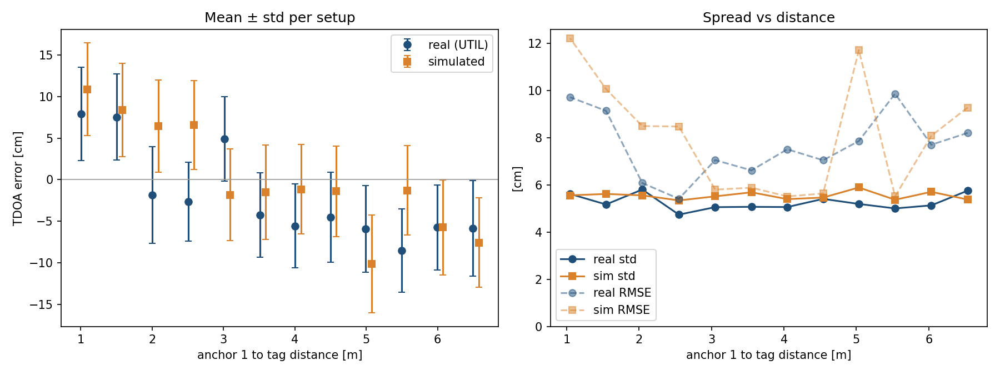
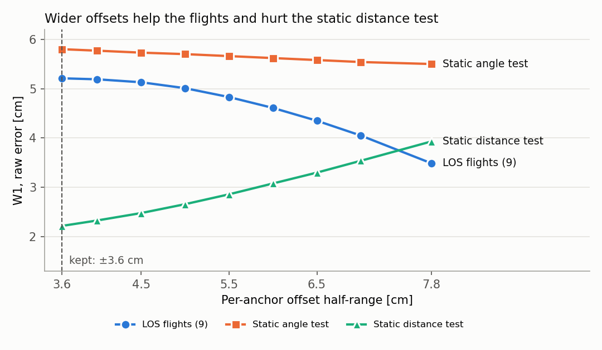

# Measurement model

The `UWBGazeboPlugin` system simulates UWB measurements between UGV anchors and UAV tags with a **link budget**. Every 100 ms of simulation time it computes, for each tag-anchor link, the excess loss $`L`$ (in dB) from free-space path loss plus every obstacle the line of sight crosses; $`L`$ sets the noise standard deviation $`\sigma`$ and the dropout probability $`p`$. It then publishes a ground truth and a simulated measurement: one link per TWR range, two links per TDOA value. Because distance and obstacles add up in the same dB budget, their relative influence follows from physical magnitudes: doubling the distance costs 6 dB, a 25 cm interior wall about 8 dB, and a 20 cm concrete wall about 20 dB (at 4 GHz).

Parameters are introduced below as `code` next to the symbol they set; all of them are listed in [Parameter reference](#parameter-reference). They live in a preset under `uwb_gazebo_plugin/presets/` (a plain `key: value` file; keys left out use the compiled-in defaults), which `./setup_simulator.sh` syncs into the plugin's block in PX4's `server.config` on every run -- pick one with `--params <name>`, in the setup GUI's "Plugin Parameters" tab, or from the terminal picker. The two shipped presets, `eliko_identification` (Eliko TWR, the default under `-y`) and `util_identification` (calibrated from the [UTIL](https://utiasdsl.github.io/util-uwb-dataset/) TDOA dataset; see [Calibration](#calibration)), are read-only from the GUI: tune one and save it under a new name.

## Ranging modes and topics

`uwb_mode` selects the ranging scheme for the whole simulation:

- **`twr`** (default) -- two-way ranging, one range per anchor-tag pair, published on `<topic>/aItJ` and `<ground_truth_topic>/aItJ` (anchor `I`, tag `J`; defaults `/uwb_gz_simulator/distances[_ground_truth]`). The offboard nodes re-package them into `eliko_messages/DistancesList`, the same format as the real Eliko driver.
- **`tdoa`** -- time difference of arrival against a reference anchor, as in Bitcraze's Loco Positioning System, published on `<tdoa_topic>/aIaKtJ` and `<tdoa_ground_truth_topic>/aIaKtJ` (reference `I`, anchor `K`, tag `J`; defaults `/uwb_gz_simulator/tdoa[_ground_truth]`). There's no `eliko_messages` equivalent, so these stay on GZ topics only.

## Link geometry

For a tag at $`\mathbf{p}_t`$ and an anchor at $`\mathbf{a}`$, the true range is $`d = \lVert \mathbf{p}_t - \mathbf{a} \rVert`$. The segment between them, minus `nlos_endpoint_margin_m` at each end (to ignore the vehicles' own mounts), is intersected with every obstacle -- every world model except `ground_plane` and the UWB-carrying vehicles: exactly with box collisions (in each box's own, possibly rotated, frame), and through the link's world-axis-aligned bounding box (AABB) for any other shape. Chord lengths are merged per material, so overlapping links of one wall aren't counted twice:

- $`\ell_m`$ -- chord length through obstacles of material $`m`$. Untagged obstacles are the `generic` material. With `enable_material_attenuation: true`, an obstacle is tagged by a `__material_<name>` suffix on its link or model name, e.g. `wall_1__material_concrete`; the known materials are in the [Material table](#material-table), and an unknown name logs a warning once and counts as `generic`.
- $`\ell_{\text{body}}`$ -- chord length through the vehicles' `base_link`s.

## Link budget

```math
L = \underbrace{10\, n \log_{10} \max(d, 1\,\mathrm{m})}_{L_d} \;+\; \underbrace{\sum_{m} \alpha_m \ell_m \;+\; L_{\text{metal}}\, \mathbf{1}[\ell_{\text{metal}} > 0] \;+\; \min\big(\alpha_{\text{generic}}\, \ell_{\text{body}},\ L_{\text{body}}\big)}_{L_{\text{obs}}}
```

- $`L_d`$ is free-space path loss relative to 1 m, with path-loss exponent $`n`$ = `path_loss_exponent` (2 in free space).
- $`\alpha_m`$ is material $`m`$'s attenuation rate in dB/m at the carrier frequency $`f`$ = `carrier_frequency_ghz`. For ITU-R P.2040 building materials (concrete, plasterboard, wood, glass), with relative permittivity $`\varepsilon_r = a`$ and conductivity $`\sigma_c = c\, f^{d}`$ S/m from that recommendation's Table 3, $`\alpha = 1636\, \sigma_c / \sqrt{\varepsilon_r}`$; for the other dielectrics, $`\alpha = 90.96\, f\, \sqrt{\varepsilon_r}\, \tan\delta`$ from their loss tangent. Override any rate as `material_<name>_attenuation_db_per_m`.
- Metal isn't penetrated: the first path detours around it, costing $`L_{\text{metal}}`$ = `material_metal_detour_loss_db` once per link however many metal obstacles it crosses.
- The vehicles' own bodies use the generic rate, capped at $`L_{\text{body}}`$ = `body_shadow_max_loss_db` (a partial blockage by a chassis never kills the link on its own).

A link is **NLOS** if $`L_{\text{obs}} \ge`$ `nlos_min_loss_db` (3 dB by default -- about 10 cm of generic wall at 4 GHz), and **LOS** otherwise. The NLOS regimes follow from where the total loss falls in the budget, so they depend on distance as well as on the obstacle:

| Regime | Condition | Effect |
| --- | --- | --- |
| LOS | $`L_{\text{obs}} <`$ `nlos_min_loss_db` | distance only |
| Soft NLOS | NLOS and $`L < L_{\sigma 0}`$ | $`\sigma`$, $`p`$ unchanged; folded (positive) noise and material bias only |
| Hard NLOS | NLOS and $`L_{\sigma 0} \le L < L_{\max}`$ | $`\sigma`$ and $`p`$ grow |
| Blackout | $`L \ge L_{\max}`$ | no measurement |

At the 3.7 m separation of the paper's NLOS experiment, generic walls of 0.25 m, 0.75 m and 1.2 m fall in Soft NLOS, Hard NLOS and Blackout respectively, as in that experiment; the same 0.25 m wall at 20 m is already Hard NLOS.

## Noise standard deviation and dropout probability

```math
\sigma = \sigma_{\min} \left(\frac{\sigma_{\max}}{\sigma_{\min}}\right)^{\mathrm{clamp}\left(\frac{L - L_{\sigma 0}}{L_{\sigma 1} - L_{\sigma 0}},\ 0,\ 1\right)}
\qquad
p =
\begin{cases}
1 & L \ge L_{\max} \\
1 - (1 - p_{\min}) \left(1 - \dfrac{1}{1 + e^{-(L - L_{50})/w}}\right) & \text{otherwise}
\end{cases}
```

- $`\sigma`$ stays at $`\sigma_{\min}`$ = `min_noise_stddev_cm` up to $`L_{\sigma 0}`$ = `noise_start_loss_db`, then grows exponentially in dB (a power law in distance) to $`\sigma_{\max}`$ = `max_noise_stddev_cm` at $`L_{\sigma 1}`$ = `noise_end_loss_db`.
- $`p`$ combines an independent floor $`p_{\min}`$ = `min_dropout_probability` (random packet loss) with a logistic link failure as the budget runs out, centred on $`L_{50}`$ = `dropout_mid_loss_db` with width $`w`$ = `dropout_width_db`. Beyond $`L_{\max}`$ = `max_link_loss_db` the link is closed.
- With `enable_nlos_dropout: false`, dropout uses $`L_d`$ only (obstacles don't drop measurements); noise still uses the full $`L`$.

## Moving-tag outliers

While a tag moves (more than 1 cm between updates), each of its links independently reads long with probability $`p_o`$ = `moving_outlier_probability`, by an exponentially distributed excess of mean $`m_o`$ = `moving_outlier_mean_cm`. The excess is added to the noise $`\tilde n`$ defined below. A still tag is never affected, because UTIL's static recordings have almost no such samples while its flights do. Off by default ($`p_o = 0`$). This is an empirical term: it reproduces the error distribution, but the physical cause isn't established.

## Deterministic bias

Each link also carries a deterministic range bias $`\beta`$ from three sources:

```math
\beta = \underbrace{\sum_{m \neq \text{metal}} \ell_m \left(\sqrt{\varepsilon_{r,m}} - 1\right)}_{\text{dielectric delay}} + \underbrace{\beta_{\text{metal}}\, \mathbf{1}[\ell_{\text{metal}} > 0]}_{\text{metal detour}} + \underbrace{k_P \left(L - L_P\right)}_{\text{received power}}
```

- **Dielectric delay** -- a dielectric slows the signal to $`c/\sqrt{\varepsilon_r}`$ ($`\varepsilon_{r,m}`$ = `material_<name>_permittivity`). **Off by default** (`enable_dielectric_delay: false`): it holds for solid slabs, but on UTIL's NLOS data, where the obstacles are mostly-hollow objects represented as solid boxes, it over-predicts their shifts. `generic` has $`\varepsilon_r = 1`$ (no delay) even when enabled, since an untagged obstacle's real material is unknown.
- **Metal detour** -- an optional fixed bias $`\beta_{\text{metal}}`$ = `material_metal_detour_bias_cm` once per link crossing metal, **0 by default**: on UTIL's NLOS data the detour loss's own power bias and NLOS folding already reproduce metal's shift (-34.2 cm predicted vs -35.2 cm real), and a bias on top double-counts it.
- **Received power** -- the DW1000's timestamp has a bias that varies with received signal level, weaker signals reading longer (Decawave application note APS011, Section 3 and Table 2). It's modelled as linear in the loss, $`k_P`$ = `power_bias_cm_per_db` per dB relative to $`L_P`$ = `power_bias_ref_loss_db`; in TDOA, $`L_P`$ cancels between the two legs and only $`k_P`$ matters. Off by default; `util_identification` fits $`k_P`$ from UTIL's LOS distance test. APS011's curve saturates, so the linear form holds only over the fitted range (1-6.5 m).

## TWR measurement

For anchor $`j`$ and tag $`t`$, the ground truth $`d_{jt}`$ is always published. With probability $`p`$ no simulated range is published that cycle; otherwise

```math
\tilde r_{jt} = \max\left(0,\ d_{jt} + \tilde n + \beta + b_{jt}\right), \qquad
n \sim \mathcal{N}(\mu, \sigma^2), \qquad
\tilde n =
\begin{cases}
-n & \text{NLOS and } n < 0 \\
n & \text{otherwise}
\end{cases}
```

- $`\mu`$ = `gaussian_noise_mean_cm`.
- $`b_{jt} \sim \mathcal{U}(b_{\min}, b_{\max})`$, with $`b_{\min}, b_{\max}`$ = `bias_min_cm`, `bias_max_cm`, is drawn once per pair and kept for the whole run when `apply_pair_bias` is on (0 otherwise).
- Folding $`n`$ in NLOS models the first path arriving late, never early: for $`\mu = 0`$ it adds a mean of $`\sigma\sqrt{2/\pi} \approx 0.8\sigma`$ on top of the deterministic $`\beta`$.

## TDOA measurement

The reference anchor $`i`$ is the one with the lowest numeric id. Each leg $`k`$ (tag to anchor $`k`$) is evaluated as a link of its own, with error

```math
e_k = \tilde n_k + \beta_k + b_k, \qquad b_k \sim \mathcal{U}(b_{\min}, b_{\max}) \text{ once per anchor}
```

($`\tilde n_k`$ folded in NLOS as above). For every other anchor $`j`$, the ground truth (Zhao et al. 2023, Eq. 1) and the measurement are

```math
d_{ij} = \lVert \mathbf{p}_t - \mathbf{a}_j \rVert - \lVert \mathbf{p}_t - \mathbf{a}_i \rVert, \qquad
\tilde d_{ij} = d_{ij} + e_j - e_i .
```

- **The reference leg is shared.** $`e_i`$ is drawn once per tag per cycle and enters every $`\tilde d_{ij}`$ of that tag. If the reference leg drops out (probability $`p_i`$), all of that tag's TDOA values are lost that cycle; otherwise each $`\tilde d_{ij}`$ is additionally lost with probability $`p_j`$. Marginally, $`P(\text{lost}) = 1 - (1 - p_i)(1 - p_j)`$.
- **Errors are correlated across pairs**, as on real TDOA hardware: $`\mathrm{Cov}(\tilde d_{ij}, \tilde d_{ik}) = \mathrm{Var}(e_i)`$, a correlation of 0.5 when all legs have equal $`\sigma`$.
- **NLOS errors keep their sign.** NLOS on anchor $`j`$'s leg pushes $`\tilde d_{ij}`$ up; NLOS on the reference leg pulls *every* $`\tilde d_{ij}`$ of that tag down.
- $`\mu`$ and the tag's own antenna delay cancel in the difference, which is why the persistent bias is per anchor ($`b_j - b_i`$), not per pair.
- For LOS legs, $`\mathrm{Var}(\tilde d_{ij}) = \sigma_i^2 + \sigma_j^2`$, which is why `util_identification` derives its per-link $`\sigma`$ as the measured TDOA spread divided by $`\sqrt{2}`$. Both modes share the same per-link model, so switching modes needs no recalibration.

## Material table

Attenuation rates $`\alpha`$ (dB/m) at DW1000 channels 2 and 5, and relative permittivity:

| Material | $`\varepsilon_r`$ | $`\alpha`$, 4 GHz | $`\alpha`$, 6.5 GHz | Source |
| --- | ---: | ---: | ---: | --- |
| `generic` (untagged) | 1.00 | 31.0 | 48.8 | plasterboard rate, no excess delay |
| `plasterboard` | 2.73 | 31.0 | 48.8 | ITU-R P.2040 |
| `concrete` | 5.24 | 97.7 | 142.8 | ITU-R P.2040 |
| `wood` | 1.99 | 24.1 | 40.5 | ITU-R P.2040 |
| `glass` | 6.31 | 15.0 | 28.8 | ITU-R P.2040 |
| `plastic` | 2.50 | 5.8 | 9.3 | $`\tan\delta = 0.01`$ |
| `cardboard` | 1.20 | 1.2 | 1.9 | $`\tan\delta = 0.003`$ (mostly air) |
| `foam` | 1.05 | 0.2 | 0.3 | $`\tan\delta = 0.0005`$ |
| `metal` | -- | -- | -- | detour: 20 dB loss, 0 cm bias |

The plastic, cardboard and foam loss tangents and the 20 dB metal detour loss aren't from a standard: they're assumptions, tested on UTIL's NLOS objects and flights. Some resulting links with the `eliko_identification` defaults (4 GHz, material model on; no deterministic bias, since that preset has no power bias and the delay and detour bias are off):

| Link | $`L_{\text{obs}}`$ (dB) | $`L`$ (dB) | Regime | $`\sigma`$ (cm) | $`p`$ |
| --- | ---: | ---: | --- | ---: | ---: |
| LOS, 5 m / 40 m / 70 m | 0 | 14.0 / 32.0 / 36.9 | LOS | 12.0 / 28.7 / 47.0 | 0.020 / 0.096 / 0.737 |
| generic 0.25 m, 3.7 m | 7.7 | 19.1 | Soft NLOS | 12.0 | 0.020 |
| generic 0.25 m, 20 m | 7.7 | 33.8 | Hard NLOS | 34.1 | 0.239 |
| generic 0.5 m, 3.7 m | 15.5 | 26.8 | Hard NLOS | 16.9 | 0.022 |
| generic 0.75 m, 3.7 m | 23.2 | 34.6 | Hard NLOS | 37.1 | 0.355 |
| generic 1.0 m, 3.7 m | 31.0 | 42.4 | Blackout | -- | 1 |
| foam / cardboard 0.3 m, glass 6 mm, 5 m | < 1 | 14.0-14.3 | LOS | 12.0 | 0.020 |
| plastic 0.3 m, 5 m | 1.7 | 15.7 | LOS | 12.0 | 0.020 |
| wood 0.3 m, 5 m | 7.2 | 21.2 | Soft NLOS | 12.0 | 0.020 |
| concrete 0.2 m, 5 m | 19.5 | 33.5 | Hard NLOS | 33.3 | 0.211 |
| metal, 5 m | 20.0 | 34.0 | Hard NLOS | 34.9 | 0.267 |

The same wall matters more the farther apart the robots are, since it eats into a budget distance has already spent (compare the two 0.25 m rows).

## Limitations

- Box collisions are intersected exactly, including rotated ones; any other collision shape (meshes, cylinders, ...) falls back to its link's world-axis-aligned bounding box, which over-estimates the blocked length.
- One straight ray per link: no explicit multipath, and no diffraction around obstacle edges (the metal detour loss and bias are constants, not computed from geometry). The moving-tag outliers are a statistical stand-in, the same for every anchor and uncorrelated in time.
- Overlapping obstacles of *different* materials each count their own chord length.
- The outlier-heavy behaviour UTIL shows behind some plastic and cabinet obstacles (mostly accurate readings with occasional large misses) isn't modelled.
- The TDOA reference anchor is fixed (lowest id), and clock synchronisation between anchors isn't simulated.

## Parameter reference

| Parameter | Symbol or role | Default |
| --- | --- | --- |
| **Ranging mode and topics** | | |
| `uwb_mode` | `twr` or `tdoa` | `twr` |
| `topic`, `ground_truth_topic` | TWR measurements, ground truth | `/uwb_gz_simulator/distances`, `/uwb_gz_simulator/distances_ground_truth` |
| `tdoa_topic`, `tdoa_ground_truth_topic` | TDOA measurements, ground truth | `/uwb_gz_simulator/tdoa`, `/uwb_gz_simulator/tdoa_ground_truth` |
| **Link budget** | | |
| `path_loss_exponent` | $`n`$ | `2.0` |
| `max_link_loss_db` | $`L_{\max}`$ | `37.5` |
| **Noise** | | |
| `min_noise_stddev_cm`, `max_noise_stddev_cm` | $`\sigma_{\min}`$, $`\sigma_{\max}`$ | `12.0`, `50.0` |
| `noise_start_loss_db`, `noise_end_loss_db` | $`L_{\sigma 0}`$, $`L_{\sigma 1}`$ | `23.5`, `37.5` |
| `gaussian_noise_mean_cm` | $`\mu`$ | `0.0` |
| `moving_outlier_probability`, `moving_outlier_mean_cm` | $`p_o`$, $`m_o`$ | `0.0`, `30.0` |
| **Dropout** | | |
| `min_dropout_probability` | $`p_{\min}`$ | `0.02` |
| `dropout_mid_loss_db`, `dropout_width_db` | $`L_{50}`$, $`w`$ | `35.5`, `1.4` |
| `enable_nlos_dropout` | obstacles affect dropout | `true` |
| **Obstacles** | | |
| `nlos_endpoint_margin_m` | ignored length at each segment end | `0.02` |
| `nlos_min_loss_db` | NLOS threshold on $`L_{\text{obs}}`$ | `3.0` |
| `body_shadow_max_loss_db` | $`L_{\text{body}}`$ | `10.0` |
| **Materials** | | |
| `enable_material_attenuation` | `__material_<name>` tags on/off | `false` |
| `carrier_frequency_ghz` | $`f`$ (DW1000 channel 2) | `4.0` |
| `material_<name>_attenuation_db_per_m` | $`\alpha_m`$ override (any material but `metal`) | from $`f`$, see [Material table](#material-table) |
| `material_<name>_permittivity` | $`\varepsilon_{r,m}`$ override (any material but `metal`) | see [Material table](#material-table) |
| `material_metal_detour_loss_db`, `material_metal_detour_bias_cm` | $`L_{\text{metal}}`$, $`\beta_{\text{metal}}`$ | `20.0`, `0.0` |
| `enable_dielectric_delay` | dielectric-delay term on/off | `false` |
| **Persistent bias** | | |
| `apply_pair_bias` | persistent bias on/off | `false` |
| `bias_min_cm`, `bias_max_cm` | $`b_{\min}`$, $`b_{\max}`$ | `-27.0`, `20.0` |
| `power_bias_cm_per_db`, `power_bias_ref_loss_db` | $`k_P`$, $`L_P`$ | `0.0`, `0.0` |
| `random_seed` | noise/bias seed; `0` = fixed default seed | `0` |

The per-material overrides aren't shown in the setup GUI (saving from it would freeze the frequency-derived rates); add them to a preset by hand.

## Calibration

### Eliko preset (`eliko_identification`)

The Eliko preset was measured in LOS at short range (σ ≈ 12 cm, near-zero bias, robots < 10 m apart) and completed with the datasheet's 75 m maximum range and ~50 cm noise near it (see the Robot Meets Ranging workshop paper, Section II-B and Table II). With $`n = 2`$, 15 m and 75 m are 23.5 dB and 37.5 dB, so the defaults reproduce those points exactly, and the link budget sets the shape in between:

| $`d`$ (m) | 5 | 10 | 15 | 30 | 45 | 60 | 70 | > 75 |
| --- | ---: | ---: | ---: | ---: | ---: | ---: | ---: | ---: |
| $`\sigma`$ (cm) | 12.0 | 12.0 | 12.0 | 22.2 | 31.8 | 41.0 | 47.0 | -- |
| $`p`$ | 0.020 | 0.020 | 0.020 | 0.032 | 0.161 | 0.523 | 0.737 | 1 |

$`L_{50}`$ and $`w`$ are a least-squares fit over 10-70 m to the published calibration's dropout, which rises from 2% at 10 m to 90% at 70 m (rms error 0.04). The dataset doesn't cover NLOS, so obstacle losses come from the material rates rather than from that calibration.

### UTIL preset (`util_identification`)

Calibrated and validated against the [UTIL](https://utiasdsl.github.io/util-uwb-dataset/) dataset [Zhao et al.]: static identification recordings first, then flights through the full pipeline (PX4 SITL, Gazebo, ROS 2, offboard control).

| Parameter | Value | Origin |
| --- | --- | --- |
| `min_noise_stddev_cm` | 4.0 | UTIL's LOS TDOA spread divided by $`\sqrt 2`$ |
| `power_bias_cm_per_db` | 0.98 | Fitted on the LOS distance test ($`\pm`$ 0.18 cm/dB) |
| `bias_min_cm`, `bias_max_cm` | -3.6, 3.6 | Scatter of the distance test's per-setup means |
| `material_metal_detour_loss_db` | 20 | Assumed; reproduces the static metal shift |
| `material_metal_detour_bias_cm`, `enable_dielectric_delay` | 0, `false` | Both over-predicted the static NLOS shifts |
| `enable_nlos_dropout` | `false` | Metal-blocked pairs keep 78-99 % of the unblocked sample rate in UTIL's flights |
| `moving_outlier_probability`, `moving_outlier_mean_cm` | 0.05, 25 | Fitted on the flights; checked on held-out flights |

Results below compare real and simulated TDOA errors with the Wasserstein-1 distance (W1, in cm). Robust std is 1.4826 times the median absolute deviation.

#### Static experiments

LOS (*centred* = each setup's mean removed):

| Test | W1 raw | W1 centred | Robust std real / sim (centred) | Per-setup mean, real / sim |
| --- | ---: | ---: | --- | --- |
| Distance (12 setups) | 2.22 | 0.62 | 4.78 / 5.49 | -2.03 ± 5.63 / 0.14 ± 6.58 |
| Angle (12 setups) | 5.80 | 1.17 | 4.32 / 5.73 | 5.70 ± 2.32 / 0.36 ± 2.70 |



NLOS, 6 placements per material; *shift* = mean error minus the LOS baseline's, for an obstacle on the anchor-tag line (anTag) or the anchor-anchor line (anAn). W1 for the LOS baseline: 0.75 cm.

| Obstacle | anTag shift real / sim | anTag W1 | anAn shift real / sim | anAn W1 |
| --- | --- | ---: | --- | ---: |
| Cardboard | +0.5 / -5.2 | 6.12 | +0.7 / -0.1 | 1.64 |
| Foam | -0.4 / -1.8 | 2.06 | -0.2 / +0.1 | 0.94 |
| Plastic | -3.5 / -8.5 | 5.42 | -3.5 / -1.4 | 5.28 |
| Wooden cabinet | -9.4 / -14.6 | 9.46 | -0.1 / -1.0 | 1.34 |
| Wooden shelf | -16.8 / -16.2 | 3.27 | +0.8 / -2.8 | 3.94 |
| Metal | -35.2 / -35.3 | 6.88 | +0.6 / -1.3 | 3.57 |


Most of the real spread behind an obstacle is between placements, not between samples. Within one placement the robust std is 7.1 cm behind metal and 4.6-6.1 cm behind wood, against 4.9 cm in LOS. Between placements, the median shift varies by 14.9 cm for metal and 7.3 cm for the wooden cabinet, whose obstacle loss hardly changes. The wooden shelf's 13.7 cm comes mostly from its chord length, which the model reproduces.

#### LOS flights (constellations 1-3, trials 1-3)

| | real | simulated |
| --- | ---: | ---: |
| Robust std, each pair's median removed | 7.88 cm | 6.70 cm |
| Spread of per-pair median errors | 7.49 cm | 3.50 cm |
| Bias slope $`k`$, pooled | 0.77 cm/dB | 0.94 cm/dB |

W1 is 3.07 cm raw and 1.75 cm with each pair's median removed (5.20 and 3.78 cm without the moving-tag outliers). By constellation:

| Constellation | W1, medians removed | Raw robust std, real / sim |
| --- | ---: | --- |
| 1 | 1.1-1.6 cm | 10.9 / 7.5 cm |
| 2 | 1.0-1.4 cm | 9.7 / 8.0 cm |
| 3 | 6.7-7.4 cm | 14.2 / 7.7 cm |

The outlier values were fitted on these flights, so they were also checked on trial 4 of each constellation, which played no part in the fit. W1 raw / with medians removed, in cm:

| Held-out flight | Without outliers | With outliers |
| --- | --- | --- |
| Constellation 1, trial 4 | 4.29 / 2.06 | 2.81 / 1.36 |
| Constellation 2, trial 4 | 3.00 / 1.66 | 1.75 / 0.93 |
| Constellation 3, trial 4 | 9.49 / 9.07 | 7.40 / 7.20 |


*In this figure and the next, the error's "pair mean" is the pair median; slope points use samples within 30 cm of it.*

- **The noise shape and the power bias transfer to flight.** Per flight, the slope averages 0.82 ± 0.21 cm/dB, consistent with the static fit.
- **Moving tags have outliers that static ones don't.** More than 30 cm from the pair's median: 0.0 % in static LOS, about 1 % in constellations 1-2 and 10 % in constellation 3. The moving-tag term gives a uniform 3 %, which improves every group but overshoots the first and undershoots the second.
- **Per-anchor offsets are larger than the preset's.** Over 8 radios the real spread is about 4.5 cm per anchor, against 2.1 cm simulated. Widening the preset's range fits the flights better but makes the static fit worse, and no value in between avoids it (this comparison predates the outlier term):



- **Constellation 3 remains the worst LOS case, and its errors are concentrated in two anchors.** Anchors 6 and 3 read more than 30 cm long in 26 % and 15 % of their samples, the other six in 1-4 %. These errors fade within about 0.25 m of tag travel and mostly don't repeat at the same place between flights, so they don't look like fixed reflections. The cause isn't known, and a per-anchor term was left out for simplicity.
- **About 0.7 % of the real samples are corrupted**: their TDOA exceeds the anchor baseline by up to 120 m. They were excluded from the comparison.

#### NLOS flights (constellation 4, trial 4: one metal and three wooden boxes)

| Pair type | Robust std real / sim | Outliers real / sim | Rate vs unblocked, real / sim |
| --- | --- | --- | --- |
| Unblocked | 13.3 / 7.3 cm | 10.4 / 3.0 % | |
| Wood | 12.2 / 6.7 cm | 8.6 / 2.9 % | 1.11-1.15 / 1.01 |
| Metal | 34.7 / 29.3 cm | 41.9 / 27.8 % | 0.78-0.99 / 1.00 |

Outliers are samples more than 30 cm from their pair's median, with the three flights pooled per pair. W1 is 7.89 cm raw and 11.38 cm with each pair's median removed (8.58 and 13.17 cm without the moving-tag outliers). Flights aren't bit-reproducible even with the same seed: repeating this set without changes moved W1 by about 0.3 cm.


- **Metal matches in sign, sample rate and most of the scatter, but not in size.** The blocked leg reads 28 cm long in reality and 58 cm in the simulation. The static test matches because its total loss is lower, and noise grows steeply with loss. Taking the detour loss out of the noise curve brings the leg to 37 cm, but it removes the scatter too (11.5 cm against the real 34.7) and worsens W1 to 13.3 cm, so it was rejected.
- **Wood adds no measurable scatter**, in reality or in the simulation. It does add bias, roughly as modelled.
- **Constellation 4 is noisier than the simulation even on unblocked pairs**, like constellation 3, despite the outlier term.
- **Box positions weren't surveyed in UTIL's flights.** They were placed 0.5 m in front of each anchor, so the simulated metal effect also depends on that assumption.

Flights reproduce UTIL's paths, not its timing: the UAV covered 89-100 % of each path with a median tracking error of 3-7 cm. Anchors were carried by `static: true` robots at their surveyed positions.

## References

- Decawave, *APS011 Application Note: Sources of Error in DW1000 Based Two-Way Ranging (TWR) Schemes*, v1.0, 2014.
- ITU-R Recommendation P.2040-3, *Effects of building materials and structures on radiowave propagation above about 100 MHz*.
- W. Zhao, A. Goudar, X. Qiao, A. P. Schoellig, "UTIL: An Ultra-Wideband Time-Difference-of-Arrival Indoor Localization Dataset", IJRR, 2024. Data: https://github.com/utiasDSL/util-uwb-dataset
- A. Martínez-Silva, D. Alejo, L. Merino, F. Caballero, "UWBPX4Sim: Ultra-Wideband simulator for multi-robot applications", Robot Meets Ranging workshop, ICRA 2026.
