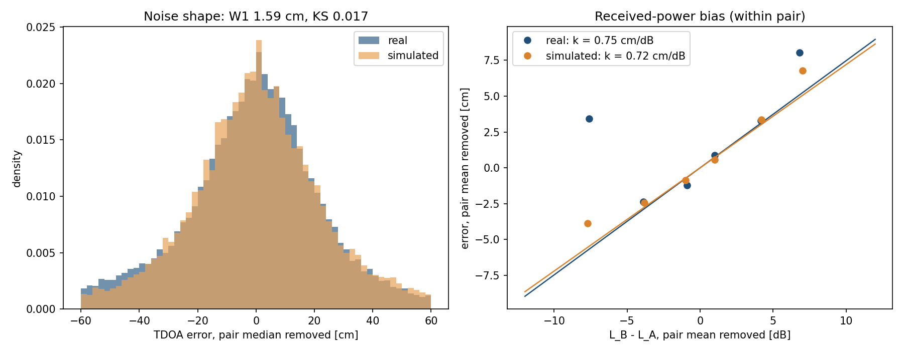

# Measurement model

New to UWB? Start with [UWB basics](uwb_basics.md), which explains ranging, TWR and TDoA, and the usual setups.

The `UWBGazeboPlugin` system simulates UWB measurements between anchors and tags with a **link budget**. At every update (`update_rate_hz`, 10 Hz by default) it computes, for each tag-anchor link, the excess loss $`L`$ (in dB) from free-space path loss plus every obstacle the line of sight crosses; $`L`$ sets the noise standard deviation $`\sigma`$ and the dropout probability $`p`$. It then publishes a ground truth and a simulated measurement: one link per TWR range, two links per TDOA value. Because distance and obstacles add up in the same dB budget, their relative influence follows from physical magnitudes: doubling the distance costs 6 dB, a 25 cm interior wall about 8 dB, and a 20 cm concrete wall about 20 dB (at 4 GHz).

Parameters are introduced below as `code` next to the symbol they set; all of them are listed in [Parameter reference](#parameter-reference). They live in a preset under `uwb_gazebo_plugin/presets/` (a plain `key: value` file; keys left out use the compiled-in defaults), which `./setup_simulator.sh` syncs into the plugin's block in PX4's `server.config` on every run -- pick one with `--params <name>`, in the setup GUI's "Plugin Parameters" tab, or from the terminal picker. The three shipped presets, one per system and mode, are `eliko_twr` (Eliko TWR, the default under `-y`), `lps_tdoa` (Bitcraze Loco Positioning TDOA, calibrated from the [UTIL](https://utiasdsl.github.io/util-uwb-dataset/) dataset [1]) and `lps_twr` (Loco Positioning TWR, calibrated from flights by Pfeiffer et al. [2]); see [Calibration](#calibration). They are read-only from the GUI: tune one and save it under a new name.

## Contents

- [Ranging modes and topics](#ranging-modes-and-topics)
- [Measurement rate](#measurement-rate)
- [Link geometry and budget](#link-geometry-and-budget)
  - [Link geometry](#link-geometry)
  - [Link budget](#link-budget)
- [Noise, dropout and bias](#noise-dropout-and-bias)
  - [Noise standard deviation and dropout probability](#noise-standard-deviation-and-dropout-probability)
  - [Moving outliers](#moving-outliers)
  - [Deterministic bias](#deterministic-bias)
- [TWR measurement](#twr-measurement)
- [TDOA measurement](#tdoa-measurement)
- [Calibration](#calibration)
  - [Eliko TWR preset (`eliko_twr`)](#eliko-twr-preset-eliko_twr)
  - [Loco Positioning TDOA preset (`lps_tdoa`)](#loco-positioning-tdoa-preset-lps_tdoa)
  - [Loco Positioning TWR preset (`lps_twr`)](#loco-positioning-twr-preset-lps_twr)
- [Sim-to-real gap](#sim-to-real-gap)
- [Parameter reference](#parameter-reference)
- [Material table](#material-table)
- [References](#references)

## Ranging modes and topics

`uwb_mode` selects the ranging scheme for the whole simulation:

- **`twr`** (default) -- one range per anchor-tag pair, published on `<topic>/aItJ` and `<ground_truth_topic>/aItJ` (anchor `I`, tag `J`; defaults `/uwb_gz_simulator/distances[_ground_truth]`). The offboard nodes re-package them into `eliko_messages/DistancesList`, the same format as the real Eliko driver.
- **`tdoa`** -- one difference of distances per anchor against a reference anchor (downlink TDoA, as in Bitcraze's Loco Positioning System), published on `<tdoa_topic>/aIaKtJ` and `<tdoa_ground_truth_topic>/aIaKtJ` (reference `I`, anchor `K`, tag `J`; defaults `/uwb_gz_simulator/tdoa[_ground_truth]`). There's no `eliko_messages` equivalent, so these stay on GZ topics only.

## Measurement rate

`update_rate_hz` sets how often every link is measured, from 1 to 75 Hz (default 10 Hz); values outside are clamped with a warning. Updates follow simulation time on a fixed schedule, so the rate is exact even when it doesn't divide the physics step.

- **Hardware limit:** Eliko tags update at up to 75 Hz [3]. Bitcraze doesn't publish per-mode rates for its Loco Positioning System; one user reports about 62.5 updates per second with TDoA2 and 8 anchors [4].
- **Simulator cost:** the cost per update grows with the number of anchor-tag pairs and obstacles. Results depend on the machine, and PX4 and ROS 2 add their own load.
- **Every link is measured at the same time** at each update. Real systems take turns, so their rate per anchor-tag pair is lower: in UTIL's flights, about 4 measurements per second per pair.

## Link geometry and budget

### Link geometry

For a tag at $`\mathbf{p}_t`$ and an anchor at $`\mathbf{a}`$, the true range is $`d = \lVert \mathbf{p}_t - \mathbf{a} \rVert`$. The segment between them, minus `nlos_endpoint_margin_m` at each end (to ignore the vehicles' own mounts), is intersected with every obstacle -- every world model except `ground_plane` and the UWB-carrying vehicles: exactly with box collisions (in each box's own, possibly rotated, frame), and through the link's world-axis-aligned bounding box (AABB) for any other shape. Chord lengths are merged per material, so overlapping links of one wall aren't counted twice:

- $`\ell_m`$ -- chord length through obstacles of material $`m`$. Untagged obstacles are the `generic` material. With `enable_material_attenuation: true`, an obstacle's material comes from a `<uwb:material>` element inside one of its `<collision>`s or its `<model>`, or else from a `__material_<name>` suffix on its link or model name, e.g. `wall_1__material_concrete`. The most specific one wins: collision, link name, model, then model name. `<uwb:material>` is a custom SDF element, so declare its prefix on the root, `<sdf version="1.9" xmlns:uwb="https://github.com/amartinezsilva/UWBPX4Sim">` (SDF's own `<material>` only describes appearance). Names are case-insensitive. The known materials are in the [Material table](#material-table), and an unknown name logs a warning once and counts as `generic`.
- $`\ell_{\text{body}}`$ -- chord length through the vehicles' `base_link`s.

### Link budget

```math
L = \underbrace{10\, n \log_{10} \max(d, 1\,\mathrm{m})}_{L_d} \;+\; \underbrace{\sum_{m} \alpha_m \ell_m \;+\; L_{\text{metal}}\, \mathbf{1}[\ell_{\text{metal}} > 0] \;+\; \min\big(\alpha_{\text{generic}}\, \ell_{\text{body}},\ L_{\text{body}}\big)}_{L_{\text{obs}}}
```

- $`L_d`$ is free-space path loss relative to 1 m, with path-loss exponent $`n`$ = `path_loss_exponent` (2 in free space).
- $`\alpha_m`$ is material $`m`$'s attenuation rate in dB/m at the carrier frequency $`f`$ = `carrier_frequency_ghz`. For ITU-R P.2040 [5] building materials (concrete, plasterboard, wood, glass), with relative permittivity $`\varepsilon_r = a`$ and conductivity $`\sigma_c = c\, f^{d}`$ S/m from that recommendation's Table 3, $`\alpha = 1636\, \sigma_c / \sqrt{\varepsilon_r}`$; for the other dielectrics, $`\alpha = 90.96\, f\, \sqrt{\varepsilon_r}\, \tan\delta`$ from their loss tangent. The resulting rates are in the [Material table](#material-table). Override any rate as `material_<name>_attenuation_db_per_m`.
- Metal isn't penetrated: the first path detours around it, costing $`L_{\text{metal}}`$ = `material_metal_detour_loss_db` (20 dB, see the [Material table](#material-table)) once per link however many metal obstacles it crosses.
- The vehicles' own bodies use the generic rate, capped at $`L_{\text{body}}`$ = `body_shadow_max_loss_db` (a partial blockage by a chassis never kills the link on its own).

A link is **NLOS** if $`L_{\text{obs}} \ge`$ `nlos_min_loss_db` (3 dB by default -- about 10 cm of generic wall at 4 GHz), and **LOS** otherwise. The NLOS regimes follow from where the total loss falls in the budget, so they depend on distance as well as on the obstacle:

| Regime | Condition | Effect |
| --- | --- | --- |
| LOS | $`L_{\text{obs}} <`$ `nlos_min_loss_db` | distance only |
| Soft NLOS | NLOS and $`L < L_{\sigma 0}`$ | $`\sigma`$, $`p`$ unchanged; folded (positive) noise and material bias only |
| Hard NLOS | NLOS and $`L_{\sigma 0} \le L < L_{\max}`$ | $`\sigma`$ grows, and $`p`$ too with `enable_nlos_dropout: true` |
| Blackout | $`L \ge L_{\max}`$ | no measurement (with `enable_nlos_dropout: false`, only when distance alone reaches $`L_{\max}`$) |

At the 3.7 m separation of the paper's NLOS experiment, generic walls of 0.25 m, 0.75 m and 1.2 m fall in Soft NLOS, Hard NLOS and Blackout respectively, as in that experiment; the same 0.25 m wall at 20 m is already Hard NLOS. The [Material table](#material-table) lists more examples by material.

## Noise, dropout and bias

### Noise standard deviation and dropout probability

```math
\sigma = \sigma_{\min} \left(\frac{\sigma_{\max}}{\sigma_{\min}}\right)^{\mathrm{clamp}\left(\frac{L - L_{\sigma 0}}{L_{\sigma 1} - L_{\sigma 0}},\ 0,\ 1\right)}
\qquad
p =
\begin{cases}
1 & L \ge L_{\max} \\
1 - (1 - p_{\min}) \left(1 - \dfrac{s(L)}{s(L_{\max})}\right) & \text{otherwise}
\end{cases}
\qquad
s(L) = \frac{1}{1 + e^{-(L - L_c)/w}}
```

- $`\sigma`$ stays at $`\sigma_{\min}`$ = `min_noise_stddev_cm` up to $`L_{\sigma 0}`$ = `noise_start_loss_db`, then grows exponentially in dB (a power law in distance) to $`\sigma_{\max}`$ = `max_noise_stddev_cm` at $`L_{\sigma 1}`$ = `noise_end_loss_db`.
- $`p`$ has two independent causes, and a measurement survives only if it escapes both, which gives the $`(1 - p_{\min})(1 - \dots)`$ product:
  - **Random packet loss:** a fixed probability $`p_{\min}`$ = `min_dropout_probability`, whatever the loss.
  - **Link failure:** as the budget runs out, the signal gets too weak to decode. This follows the S-shaped logistic curve $`s(L)`$: near 0 at low loss, rising steeply, then flattening towards 1. $`L_c`$ = `dropout_center_loss_db` sets *where* the rise happens: it's the centre of the S, where $`s`$ = 0.5. $`w`$ = `dropout_width_db` sets *how abrupt* it is: most of the rise happens within $`\pm 2w`$ of $`L_c`$ (about $`\pm 3`$ dB in the presets).
  - **Closing the link:** at $`L_{\max}`$ = `max_link_loss_db` the link is closed, but the S alone would only have reached 0.81 there. Dividing by $`s(L_{\max})`$ stretches it to reach exactly 1, so $`p`$ rises into blackout without a jump. In our preset, p=0.63 at $`L_c`$ (35.5 dB, 60 m) and 0.5 at about 34.9 dB (56 m).
- With `enable_nlos_dropout: false`, dropout uses $`L_d`$ only (obstacles don't drop measurements); noise still uses the full $`L`$.

Figure 1 shows both curves.


*Figure 1: Noise standard deviation and dropout probability against the link budget, with the `eliko_twr` values. In all presets $`L_{\sigma 1}`$ and $`L_{\max}`$ are the same, so $`\sigma`$ reaches $`\sigma_{\max}`$ just as the link closes.*

### Moving outliers

While either end of a link moves faster than `moving_outlier_min_speed_mps` (default 10 cm/s, 1 cm per update at 10 Hz), that link independently reads long with probability $`p_o`$ = `moving_outlier_probability`, by an exponentially distributed excess of mean $`m_o`$ = `moving_outlier_mean_cm`. In the measurement equations below this is the term

```math
o = B\,X, \qquad B \sim \mathrm{Bernoulli}(p_o) \text{ while moving (otherwise } B = 0\text{)}, \qquad X \sim \mathrm{Exp}(\text{mean } m_o),
```

drawn independently for every link and update. A link with both ends still is never affected, because UTIL's static recordings have almost no such samples while its flights do. UTIL's anchors never move. In the LPS TWR flights, outliers also occur while hovering, so `lps_twr` lowers the threshold to 2 mm/s: in PX4 SITL that counts a hovering drone (2-41 mm/s) as moving and a parked robot (at most 1 mm/s) as still. Off by default ($`p_o = 0`$). Please note this is an empirical term: it reproduces the error distribution, but the physical cause isn't established.

### Deterministic bias

Each link also carries a deterministic range bias $`\beta`$ from two sources:

```math
\beta = \underbrace{\sum_{m \neq \text{metal}} \ell_m \left(\sqrt{\varepsilon_{r,m}} - 1\right)}_{\text{dielectric delay}} + \underbrace{k_P \left(L - L_P\right)}_{\text{received power}}
```

- **Dielectric delay** -- a dielectric slows the signal to $`c/\sqrt{\varepsilon_r}`$ ($`\varepsilon_{r,m}`$ = `material_<name>_permittivity`, values in the [Material table](#material-table)). **Off by default** (`enable_dielectric_delay: false`): it holds for solid slabs, but on UTIL's NLOS data, where the obstacles are mostly-hollow objects represented as solid boxes, it over-predicts their shifts. `generic` has $`\varepsilon_r = 1`$ (no delay) even when enabled, since an untagged obstacle's real material is unknown.
- **Received power** -- the DW1000 timestamps weaker signals later, so they read longer (Decawave APS011 [6], Section 3 and Table 2). This is modelled as linear in the loss: $`k_P (L - L_P)`$, with $`k_P`$ = `power_bias_cm_per_db` and $`L_P`$ = `power_bias_ref_loss_db` (in TDOA, $`L_P`$ cancels between the two legs). It's 0 unless a preset sets it: `lps_tdoa` fits 0.98 cm/dB on UTIL's LOS distance test and `lps_twr` 0.99. APS011's curve saturates, so the linear form holds only over the fitted range (1-6.5 m).
- **Metal has no bias parameter of its own.** Its 20 dB detour loss already produces a received-power bias, and NLOS folding adds the rest: on UTIL's data, this reproduces metal's shift (-34.2 cm predicted vs -35.2 cm real).

## TWR measurement

For anchor $`j`$ and tag $`t`$, the ground truth $`d_{jt}`$ is always published. With probability $`p`$ no simulated range is published that cycle; otherwise

```math
\tilde r_{jt} = \max\left(0,\ d_{jt} + \tilde n + o + \beta + b_{jt}\right), \qquad
n \sim \mathcal{N}(\mu, \sigma^2), \qquad
\tilde n =
\begin{cases}
-n & \text{NLOS and } n < 0 \\
n & \text{otherwise}
\end{cases}
```

- $`\mu`$ = `gaussian_noise_mean_cm`.
- $`o`$ is the moving-outlier excess ([Moving outliers](#moving-outliers)), added after the NLOS folding.
- $`b_{jt}`$ is the pair's fixed offset. If the anchor or the tag has one set (`bias_cm` in the layout, see [Layout files](advanced_setup.md#layout-files)), $`b_{jt}`$ is the sum of the two, a missing one counting as 0, since a real TWR offset is both antenna delays together. Otherwise $`b_{jt} \sim \mathcal{U}(b_{\min}, b_{\max})`$, with $`b_{\min}, b_{\max}`$ = `bias_min_cm`, `bias_max_cm`, is drawn once per pair and kept for the whole run when `apply_pair_bias` is on (0 otherwise). Set offsets always apply.
- Folding $`n`$ in NLOS models the first path arriving late, never early: for $`\mu = 0`$ it adds a mean of $`\sigma\sqrt{2/\pi} \approx 0.8\sigma`$ on top of the deterministic $`\beta`$.

**An alternative: Pfeiffer et al.'s model.** For the Loco TWR flights used by `lps_twr`, Pfeiffer et al. [2] model the range error $`e`$ as a mixture, without distance dependence or anchor offsets:

```math
e \sim \frac{1}{1+s}\,\mathcal{N}(\mu_g, \sigma_g^2) + \frac{s}{1+s}\,\Gamma(k, \lambda)
```

with $`\mu_g = \sigma_g = 10`$ cm, $`s = 0.2`$, $`k = 2`$ and $`\lambda = 3.5`$ m⁻¹. Its Gamma term plays the role of our exponential excess. On the same flights, our model is the only one of the two that reproduces each anchor's persistent offset, and it fits the noise around each anchor's median better (see [Loco Positioning TWR preset](#loco-positioning-twr-preset-lps_twr)).

## TDOA measurement

The reference anchor $`i`$ is the one with the lowest numeric id. Each leg $`k`$ (tag to anchor $`k`$) is evaluated as a link of its own, with error

```math
e_k = \tilde n_k + o_k + \beta_k + b_k
```

($`\tilde n_k`$ folded in NLOS and $`o_k`$ the leg's moving-outlier excess, as above; $`b_k`$ is anchor $`k`$'s offset if set in the layout, otherwise drawn once per anchor from $`\mathcal{U}(b_{\min}, b_{\max})`$ when `apply_pair_bias` is on. The tag's offset cancels in the difference.). For every other anchor $`j`$, the ground truth ([1], Eq. 1) and the measurement are

```math
d_{ij} = \lVert \mathbf{p}_t - \mathbf{a}_j \rVert - \lVert \mathbf{p}_t - \mathbf{a}_i \rVert, \qquad
\tilde d_{ij} = d_{ij} + e_j - e_i .
```

- **The reference leg is shared.** $`e_i`$ is drawn once per tag per cycle and enters every $`\tilde d_{ij}`$ of that tag. If the reference leg drops out (probability $`p_i`$), all of that tag's TDOA values are lost that cycle; otherwise each $`\tilde d_{ij}`$ is additionally lost with probability $`p_j`$. Marginally, $`P(\text{lost}) = 1 - (1 - p_i)(1 - p_j)`$.
- **Errors are correlated across pairs**, as on real TDOA hardware: $`\mathrm{Cov}(\tilde d_{ij}, \tilde d_{ik}) = \mathrm{Var}(e_i)`$, a correlation of 0.5 when all legs have equal $`\sigma`$.
- **NLOS errors keep their sign.** NLOS on anchor $`j`$'s leg pushes $`\tilde d_{ij}`$ up; NLOS on the reference leg pulls *every* $`\tilde d_{ij}`$ of that tag down.
- $`\mu`$ and the tag's own antenna delay cancel in the difference, which is why the persistent bias is per anchor ($`b_j - b_i`$), not per pair.
- For LOS legs, $`\mathrm{Var}(\tilde d_{ij}) = \sigma_i^2 + \sigma_j^2`$, which is why `lps_tdoa` derives its per-link $`\sigma`$ as the measured TDOA spread divided by $`\sqrt{2}`$. Both modes share the same per-link model, but its values can differ between modes on the same hardware: on one Loco Positioning installation, TDOA legs were noisier than TWR ranges (see [A second installation](#a-second-installation)), so each mode has its own preset.

## Calibration

Each preset is checked against real data with the Wasserstein-1 distance (W1, in cm; lower is better) between real and simulated errors. *Raw* compares the errors as they are; *centred* first removes each anchor's (TWR) or anchor pair's (TDOA) median, leaving the noise shape.

### Eliko TWR preset (`eliko_twr`)

Calibrated from the Eliko dataset [8]: two anchors on a UGV ranging to two tags on a DJI Matrice M210, in LOS, with the robots less than 10 m apart. Its range errors, as characterised in [7] (Table I):

| Anchor / tag | Mean error (cm) | $`\sigma`$ (cm) | RMSE (cm) |
| --- | ---: | ---: | ---: |
| 1 / 1 | 8.69 | 12.55 | 15.08 |
| 1 / 2 | -9.51 | 11.63 | 14.94 |
| 2 / 1 | -0.04 | 9.00 | 8.84 |
| 2 / 2 | -6.83 | 10.93 | 12.78 |

The spread is just under 12 cm while moving and the mean error averages -1.9 cm, so the preset uses $`\sigma`$ = 12 cm and no bias; individual pairs are offset by up to about 10 cm, which it doesn't reproduce. Beyond the data's 10 m, it follows Eliko's documentation as used in [7]: noise rising to 50 cm at 75 m, dropout from 2 % at 10 m to 90 % at 70 m, and no measurement beyond 75 m (Figure 1). The dataset has no NLOS data, so obstacles use `lps_tdoa`'s material values: treat Eliko NLOS results as uncalibrated.

### Loco Positioning TDOA preset (`lps_tdoa`)

Calibrated on the [UTIL](https://utiasdsl.github.io/util-uwb-dataset/) dataset's static recordings [1], and validated on its flights run through the full pipeline (PX4 SITL, Gazebo, ROS 2, offboard control).

| Parameter | Value | Origin |
| --- | --- | --- |
| `min_noise_stddev_cm` | 4.0 | LOS TDOA spread divided by $`\sqrt 2`$ |
| `power_bias_cm_per_db` | 0.98 | Fitted on the LOS distance test |
| `bias_min_cm`, `bias_max_cm` | -3.6, 3.6 | Scatter of the distance test's offsets |
| `material_metal_detour_loss_db` | 20 | Reproduces the static metal shift |
| `enable_dielectric_delay` | `false` | Over-predicted the static NLOS shifts |
| `enable_nlos_dropout` | `false` | Blocked links keep 78-99 % of their sample rate in flight |
| `moving_outlier_probability`, `moving_outlier_mean_cm` | 0.05, 25 | Fitted on the flights, checked on held-out ones |

| Data | W1 raw | W1 centred |
| --- | ---: | ---: |
| Static, LOS | 2.2-5.8 | 0.6-1.2 |
| Static, obstacle on the tag link | 1.3-9.3 | -- |
| Flight, LOS | 3.07 | 1.75 |
| Flight, NLOS | 7.89 | 11.38 |

The simulation reproduces the noise, the received-power bias and the size of obstacle effects in static data, and LOS flights well. NLOS flights match in shape but less in size.

#### Static data

In LOS, the noise matches at every distance, at about 5-6 cm, and the simulated means follow the real drift from about +8 cm at 1 m to -6 cm at 6.5 m (Figure 2, left). With an obstacle on the anchor-tag line (Figure 2, right), the simulation reproduces how much each material shifts the error, relative to LOS:

| Obstacle | Real shift (cm) | Simulated shift (cm) |
| --- | ---: | ---: |
| Cardboard | +0.5 | -1.0 |
| Foam | -0.4 | 0.0 |
| Plastic | -3.5 | -7.2 |
| Wooden cabinet | -9.4 | -13.7 |
| Wooden shelf | -16.8 | -16.6 |
| Metal | -35.2 | -34.1 |

<p align="center">
  
  
</p>

*Figure 2: Static data. Left: LOS spread against distance. Right: error shift by material, with the obstacle on the anchor-tag line (anTag).*

Heavier obstacles shift the error more, in reality and in the simulation. Hollow objects (the plastic container and the wooden cabinet) are over-predicted by about 4 cm, since they're simulated as solid boxes.

#### Flight data

Flights reproduce UTIL's paths with a median tracking error of 3-7 cm, with the anchors at their surveyed positions. About 0.7 % of the real samples are corrupted (errors of up to 120 m) and were excluded.

**LOS** (Figure 3):


*Figure 3: LOS flights. Left: noise shape, with each anchor pair's median removed. Right: received-power bias. $`L_B - L_A`$ is how much weaker anchor B's signal is than anchor A's from distance alone ($`L = 20 \log_{10} d`$), and the y axis is the TDOA error; each pair's mean is removed from both axes, leaving only the changes as the tag moves. Samples more than 30 cm from the pair's median are excluded, dots are binned averages, and the slope estimates $`k_P`$.*

- **The noise shape and the received-power bias carry over from the static data** (0.77 cm/dB real against 0.94 simulated).
- **Moving tags have outliers that static ones don't** (1-10 % of flight samples more than 30 cm from the pair's median). The moving-outlier term captures them: W1 raw drops from 5.20 to 3.07 cm.
- **Some anchors are noisier, and offsets are larger in flight** (about 4.5 cm against 2.1 cm simulated). Both depend on the installation and aren't modelled (see [Sim-to-real gap](#sim-to-real-gap)).

**NLOS**, with one metal and three wooden boxes (Figure 4). The layout [`config/demo_util_nlos.yaml`](../config/demo_util_nlos.yaml) reproduces one of these flights as a ready-made demo:

| Link | Robust std, real / sim | Outliers, real / sim |
| --- | --- | --- |
| Unblocked | 13.3 / 7.3 cm | 10.4 / 3.0 % |
| Wood | 12.2 / 6.7 cm | 8.6 / 2.9 % |
| Metal | 34.7 / 29.3 cm | 41.9 / 27.8 % |


*Figure 4: NLOS flights. Panels as in Figure 3, with the real data also shown after removing the direction-dependent anchor bias (green).*

- **Metal is right in sign and scatter, but too large:** a blocked leg reads 28 cm long in reality and 58 cm in the simulation.
- **Obstacles don't stop measurements**, and wood adds bias but no measurable scatter, in reality and in the simulation.
- **A direction-dependent anchor bias hides the received-power bias:** removing it raises the real slope from 0.04 to 0.61 cm/dB, against 0.98 simulated.
- **Overall noise is about twice the simulation's**, even on unblocked links. It comes from this installation's ceiling anchors, not from the obstacles (see [Sim-to-real gap](#sim-to-real-gap)).

**With measured anchor offsets.** Setting each anchor's offset as `bias_cm`, measured on other trials of the same installation, cuts W1 raw by about a third (to 2.50 cm in LOS and 8.10 cm in NLOS, on flights replayed along their recorded paths), with the noise shape unchanged.

#### A second installation

Pfeiffer et al.'s TDoA flights [2] (a Crazyflie with the same hardware, in another arena, all 28 anchor pairs) test `lps_tdoa` on a different installation. Its noise is about three times higher than the preset's (robust std 21.3 against 6.5 cm; W1 centred 14.4 cm). The excess comes from specific low anchors, the same ones that are noisy in that arena's TWR flights, so it belongs to the installation rather than to the system or mode. The preset keeps UTIL's values, which cover more data and installations.

**To simulate a noisier installation**, start from `lps_tdoa` and set the values fitted on these flights:

| Parameter | Value |
| --- | --- |
| `min_noise_stddev_cm` | 8.9 |
| `moving_outlier_probability`, `moving_outlier_mean_cm` | 0.45, 22.7 |
| `moving_outlier_min_speed_mps` | 0.002 |
| `power_bias_cm_per_db` | 1.27 |
| `bias_min_cm`, `bias_max_cm` | -14.0, 14.0 |
| `update_rate_hz` | 5 |

With them, the plugin reproduces held-out flights (Figure 5): W1 is 1.59 cm centred, and the received-power bias is 0.75 cm/dB real against 0.72 simulated.



*Figure 5: Held-out flights of the second installation, replayed through the plugin with the values above. Panels as in Figure 3. With noise this wide, the 30 cm trimming flattens both slopes (the fitted 1.27 cm/dB shows as 0.72).*

**Alternatives considered.** This installation's TWR calibration (`lps_twr`) run in TDOA mode is 25 % too narrow, because TDOA legs have more outliers than TWR ranges, so each mode needs its own values. Adding a TDOA-only Gaussian to it fits worse than refitting the legs (W1 centred 2.92 against 1.56 cm). Pfeiffer et al.'s own TDoA model, an equal mix of Gaussian and Cauchy errors of scale 30 cm, has far too heavy tails (W1 centred 120 cm). Two data defects were excluded: a pair reading a constant 2.3 m short, and 1.25 % of values off by more than 3 m.

### Loco Positioning TWR preset (`lps_twr`)

Calibrated from the TWR flights of Pfeiffer et al.'s dataset [2]: a Crazyflie 2.1 ranging to 8 anchors in LOS, with OptiTrack ground truth. One flight of each of the 6 trajectories was used for fitting, and the other six for validation.

| Parameter | Value | Origin |
| --- | --- | --- |
| `update_rate_hz` | 30 | Measured ranges per second per anchor |
| `min_noise_stddev_cm` | 8.3 | Fitted jointly with the outliers and anchor offsets |
| `moving_outlier_probability`, `moving_outlier_mean_cm` | 0.35, 14.7 | Same fit |
| `moving_outlier_min_speed_mps` | 0.002 | Outliers also occur while hovering |
| `power_bias_cm_per_db`, `power_bias_ref_loss_db` | 0.99, 16.6 | Same fit; $`L_P`$ is the flights' mean loss (6.8 m) |
| `apply_pair_bias`, `bias_min_cm`, `bias_max_cm` | `true`, -34.4, -10.5 | The 8 anchors' offset mean and spread |
| Long-range shape, dropout floor, obstacles, materials | as `lps_tdoa` | Not covered by these flights |

The held-out flights were replayed through the plugin along their recorded paths: W1 is 3.86 cm raw and 0.96 cm centred, against 1.06 cm raw between two real flights of the same trajectory (Figure 6).


*Figure 6: Held-out Loco TWR flights replayed through the plugin. Panels as in Figure 3, per anchor instead of per anchor pair: the right panel plots the TWR error against $`L = 20 \log_{10} d`$.*

- **TWR reads short:** anchor offsets average -22.5 cm and repeat between flights (correlation 0.99). TDOA cancels a common offset, which is why UTIL needed none.
- **The received-power bias matches UTIL's:** 0.99 cm/dB fitted here, 0.98 on UTIL, on the same radio (0.72 real against 0.92 simulated in Figure 6).
- **Outliers come with flying, not with speed:** they're as frequent while hovering (4.1 % beyond 30 cm) as while moving, and rare on the ground (0.6 %). The 2 mm/s threshold counts a hovering SITL drone as moving (see [Moving outliers](#moving-outliers)).
- **The noise shape matches**, with a slightly wider simulated core (robust std 10.8 against 9.4 cm).

**With measured anchor offsets** (`bias_cm`, from the training flights), W1 raw drops from 3.86 to 2.44 cm and the error per anchor halves. The rest of the gap is what isn't modelled per anchor (see [Sim-to-real gap](#sim-to-real-gap)).

**Alternatives considered.** Pfeiffer et al.'s mixture model (see [TWR measurement](#twr-measurement)) doesn't fit these flights as published (W1 raw 35 cm): it's centred at +10 cm while the ranges read 19.5 cm short. Refitted, it performs like ours without anchor offsets, and only the per-anchor offsets reproduce the noise around each anchor (W1 centred 1.40 against 2.38 cm). A gamma-shaped excess, noise growing with distance, and a per-anchor spread of noise levels didn't improve the held-out fit, so none was added.

## Sim-to-real gap

What to keep in mind when moving from the simulator to real hardware. The numbers come from [Calibration](#calibration).

| Effect | In the simulator | Depends on | On real hardware |
| --- | --- | --- | --- |
| Received-power bias | Modelled ($`k_P`$) | The chip; distance and obstacles, through the loss | Predictable from the geometry, so an estimator can correct it |
| Obstacle (NLOS) bias and noise | Approximate: obstacles are solid boxes, so hollow ones are over-predicted | Each obstacle's size and material | Predictable only if the obstacles and their materials are mapped |
| Fixed per-transceiver offset | Approximate when drawn at random (smaller than in UTIL's flights); exact when set per transceiver | Antenna delay and mounting | Measure it with a short LOS distance test, and set it as `bias_cm` in the layout |
| Outliers while moving or flying | Approximate: the same rate for every anchor | Motion of the tag or anchor | Reject them in the estimator |
| Installation's overall noise level | One value per preset | The installation | Up to about threefold between installations; measure it with a short flight |
| Per-anchor noise and outlier level | Not modelled | Which anchors, mounted where | A calibration flight finds the noisy anchors to down-weight |
| Direction-dependent anchor bias | Not modelled | Each anchor's mounting and surroundings | A calibration flight fits part of it (4-21 % of the error variance) |
| Time-correlated errors | Not modelled | Probably the direction-dependent bias, seen over about 1 m of travel | As above |
| Reflections off walls and ceiling | Only statistically, through the noise | The room | -- |
| Corrupted values (metres off) | Not modelled | Hardware, firmware or logging | Gate them out in the estimator |
| TDOA clock synchronisation | Not modelled; its effect wasn't measured | The anchor-to-anchor links | -- |

**Also worth knowing:**
- Each link is one straight ray, so reflections off specific walls aren't traced. Non-box obstacles use their bounding box, which over-estimates the blocked length.
- TDOA uses a fixed reference anchor (lowest id), and the anchor-to-anchor link isn't simulated.
- Each run draws its own anchor offsets, so one run can move results by about 4 cm: average over seeds, or set measured offsets with `bias_cm`.
- The data covers 0.5-10 m. Beyond that, noise, dropout and the received-power bias are extrapolated, and Eliko's curves follow its documentation.
- The plastic, cardboard and foam properties and the metal detour loss are assumptions, tested only on UTIL's objects.
- `lps_twr` describes flight: on the ground, the real noise is about 3 cm with almost no outliers.
- All presets are for DW1000-based hardware (Loco, Eliko). Other radios need their own calibration.

**In practice:** test estimators with more noise and outliers than the simulation produces, and recalibrate the preset with a LOS distance test and a short flight at the target site.

## Parameter reference

| Parameter | Symbol or role | Default |
| --- | --- | --- |
| **Ranging mode and topics** | | |
| `uwb_mode` | `twr` or `tdoa` | `twr` |
| `topic`, `ground_truth_topic` | TWR measurements, ground truth | `/uwb_gz_simulator/distances`, `/uwb_gz_simulator/distances_ground_truth` |
| `update_rate_hz` | measurement rate, 1-75 Hz | `10.0` |
| `tdoa_topic`, `tdoa_ground_truth_topic` | TDOA measurements, ground truth | `/uwb_gz_simulator/tdoa`, `/uwb_gz_simulator/tdoa_ground_truth` |
| **Link budget** | | |
| `path_loss_exponent` | $`n`$ | `2.0` |
| **Noise** | | |
| `min_noise_stddev_cm`, `max_noise_stddev_cm` | $`\sigma_{\min}`$, $`\sigma_{\max}`$ | `12.0`, `50.0` |
| `noise_start_loss_db`, `noise_end_loss_db` | $`L_{\sigma 0}`$, $`L_{\sigma 1}`$ | `23.5`, `37.5` |
| `gaussian_noise_mean_cm` | $`\mu`$ | `0.0` |
| `moving_outlier_probability`, `moving_outlier_mean_cm` | $`p_o`$, $`m_o`$ | `0.0`, `30.0` |
| `moving_outlier_min_speed_mps` | slowest speed of either end that counts as moving | `0.1` |
| **Dropout** | | |
| `max_link_loss_db` | $`L_{\max}`$ | `37.5` |
| `min_dropout_probability` | $`p_{\min}`$ | `0.02` |
| `dropout_center_loss_db`, `dropout_width_db` | $`L_c`$, $`w`$ | `35.5`, `1.4` |
| `enable_nlos_dropout` | obstacles affect dropout | `true` |
| **Obstacles** | | |
| `nlos_endpoint_margin_m` | ignored length at each segment end | `0.02` |
| `nlos_min_loss_db` | NLOS threshold on $`L_{\text{obs}}`$ | `3.0` |
| `body_shadow_max_loss_db` | $`L_{\text{body}}`$ | `10.0` |
| **Materials** | | |
| `enable_material_attenuation` | material tags on/off | `false` |
| `carrier_frequency_ghz` | $`f`$ (DW1000 channel 2) | `4.0` |
| `material_<name>_attenuation_db_per_m` | $`\alpha_m`$ override (any material but `metal`) | from $`f`$, see [Material table](#material-table) |
| `material_<name>_permittivity` | $`\varepsilon_{r,m}`$ override (any material but `metal`) | see [Material table](#material-table) |
| `material_metal_detour_loss_db` | $`L_{\text{metal}}`$ | `20.0` |
| `enable_dielectric_delay` | dielectric-delay term on/off | `false` |
| **Persistent bias** | | |
| `apply_pair_bias` | random persistent bias on/off (offsets set in the layout always apply) | `false` |
| `bias_min_cm`, `bias_max_cm` | $`b_{\min}`$, $`b_{\max}`$ | `-27.0`, `20.0` |
| `power_bias_cm_per_db`, `power_bias_ref_loss_db` | $`k_P`$, $`L_P`$ | `0.0`, `0.0` |
| `random_seed` | noise/bias seed; `0` = fixed default seed | `0` |

The per-material overrides aren't shown in the setup GUI (saving from it would freeze the frequency-derived rates); add them to a preset by hand.

## Material table

Attenuation rates $`\alpha`$ (dB/m) at DW1000 channels 2 and 5, and relative permittivity:

| Material | $`\varepsilon_r`$ | $`\alpha`$, 4 GHz | $`\alpha`$, 6.5 GHz | Source |
| --- | ---: | ---: | ---: | --- |
| `generic` (untagged) | 1.00 | 31.0 | 48.8 | plasterboard rate, no excess delay |
| `plasterboard` | 2.73 | 31.0 | 48.8 | ITU-R P.2040 |
| `concrete` | 5.24 | 97.7 | 142.8 | ITU-R P.2040 |
| `wood` | 1.99 | 24.1 | 40.5 | ITU-R P.2040 |
| `glass` | 6.31 | 15.0 | 28.8 | ITU-R P.2040 |
| `plastic` | 2.50 | 5.8 | 9.3 | $`\tan\delta = 0.01`$ |
| `cardboard` | 1.20 | 1.2 | 1.9 | $`\tan\delta = 0.003`$ (mostly air) |
| `foam` | 1.05 | 0.2 | 0.3 | $`\tan\delta = 0.0005`$ |
| `metal` | -- | -- | -- | detour: 20 dB loss |

The plastic, cardboard and foam loss tangents and the 20 dB metal detour loss aren't from a standard: they're assumptions, tested on UTIL's NLOS objects and flights. Some resulting links with `eliko_twr`'s curves and `enable_nlos_dropout: true`:

| Link | $`L_{\text{obs}}`$ (dB) | $`L`$ (dB) | Regime | $`\sigma`$ (cm) | $`p`$ |
| --- | ---: | ---: | --- | ---: | ---: |
| LOS, 5 m / 40 m / 70 m | 0 | 14.0 / 32.0 / 36.9 | LOS | 12.0 / 28.7 / 47.0 | 0.020 / 0.112 / 0.908 |
| wood 0.3 m, 5 m | 7.2 | 21.2 | Soft NLOS | 12.0 | 0.020 |
| concrete 0.2 m, 5 m | 19.5 | 33.5 | Hard NLOS | 33.3 | 0.255 |
| metal, 5 m | 20.0 | 34.0 | Hard NLOS | 34.9 | 0.330 |
| generic 1.0 m, 3.7 m | 31.0 | 42.4 | Blackout | -- | 1 |

With `enable_nlos_dropout: false`, as in `lps_tdoa`, $`\sigma`$ is as shown, but $`p`$ follows distance alone, so an obstacle never causes a blackout.

## References

1. W. Zhao, A. Goudar, X. Qiao, A. P. Schoellig, "UTIL: An Ultra-Wideband Time-Difference-of-Arrival Indoor Localization Dataset", *IJRR*, 2024. Data: https://github.com/utiasDSL/util-uwb-dataset
2. S. Pfeiffer, C. de Wagter, G. C. H. E. de Croon, "A Computationally Efficient Moving Horizon Estimator for Ultra-Wideband Localization on Small Quadrotors", *IEEE RA-L*, 2021. Data: https://doi.org/10.4121/14827680
3. Eliko, *UWB RTLS: Ultra-Wideband Real-Time Location System* (tag update rate). https://eliko.tech/uwb-rtls-ultra-wideband-real-time-location-system/
4. Bitcraze discussion #1076 (TDoA2 update rate with 8 anchors, user report). https://github.com/orgs/bitcraze/discussions/1076
5. ITU-R Recommendation P.2040-3, *Effects of building materials and structures on radiowave propagation above about 100 MHz*.
6. Decawave, *APS011 Application Note: Sources of Error in DW1000 Based Two-Way Ranging (TWR) Schemes*, v1.0, 2014.
7. A. Martínez-Silva, D. Alejo, L. Merino, F. Caballero, "UWBPX4Sim: Ultra-Wideband simulator for multi-robot applications", Robot Meets Ranging workshop, ICRA 2026.
8. A. Martínez-Silva, D. Alejo, L. Merino, F. Caballero, "Radio-based Multi-Robot Odometry and Relative Localization", *IEEE ICRA*, 2026, pp. 17557–17564. https://doi.org/10.1109/ICRA57385.2026.11696767. Data: https://dataverse.harvard.edu/dataset.xhtml?persistentId=doi:10.7910/DVN/KNKWMJ
