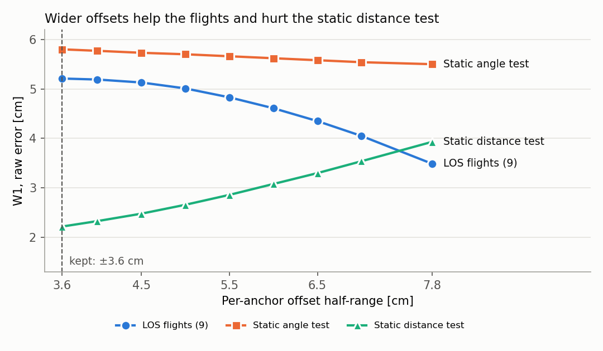

# Measurement model: decisions, justification and evidence

This is the record of every modelling decision in `UWBGazeboSystem` (the equations are in [measurement_model.md](measurement_model.md)) and in the presets, with its justification and its evidence. Each decision has a status:

| Status | Meaning |
| --- | --- |
| **Standard** | Follows from standard propagation physics; the derivation is given. |
| **Source** | Taken from a dataset, datasheet, standard or source code, cited. "Verified" means the primary source was read; otherwise the secondary route is stated. |
| **Fitted** | Estimated from data: the data, method and uncertainty are given. |
| **Assumption** | A modelling choice that no source or data in this repo backs yet. Listed again under [Open decisions](#open-decisions). |

## 1. Link budget

| # | Decision | Status | Justification / evidence |
| --- | --- | --- | --- |
| 1.1 | Losses add in dB: $`L = L_d + L_{\text{obs}}`$ | Standard | Independent power attenuations multiply; in dB they add. |
| 1.2 | $`L_d = 10\,n\log_{10} \max(d, 1\,\mathrm{m})`$, $`n = 2`$ | Standard (form); Assumption (validity of $`n = 2`$ beyond the data) | Friis' free-space formula gives received power falling as $`20\log_{10}d`$. Decawave uses the same formula for the line-of-sight first path in APS011 §3.4 [APS011]. $`n = 2`$ is not validated beyond the data used here (UTIL: 0.5-6.5 m; Eliko: < 10 m). |
| 1.3 | $`L_{\max} = 37.5`$ dB (no measurement beyond) | Source | 37.5 dB is 75 m at $`n = 2`$: the LOS blackout distance of the Eliko preset, from the Eliko datasheet as used in the Robot Meets Ranging paper (Table II). Not verified against the datasheet here. Note: Eliko's RTLS web page states an "operational range up to 50 meters" [Eliko-web] -- unresolved discrepancy. |
| 1.4 | Carrier frequency 4 GHz (DW1000 channel 2) for both presets | Source | UTIL/LPS -- verified: Bitcraze's LPS node firmware sets `dwSetChannel(dwm, CHANNEL_2)` [LPS-fw]. Eliko -- the FCC grant for the KIO positioning solution (FCC ID 2AF2IKIO4) authorises 3300-4450 MHz [FCC]; of the DW1000 channels (500 MHz wide; channel 2 centred at 3993.6 MHz [Taoglas]) only channel 2 lies entirely inside that band. The grant documents themselves weren't retrievable (HTTP 403), only the fccid.io listing via search; the grant covers the 2016 KIO4 model. |

## 2. Obstacles and materials

| # | Decision | Status | Justification / evidence |
| --- | --- | --- | --- |
| 2.1 | Obstacle loss $`\sum_m \alpha_m \ell_m`$ along the straight tag-anchor line; chords through box collisions computed exactly in each box's own (rotated) frame, other shapes through the link's axis-aligned bounding box | Assumption (single ray); Standard (box intersection) | One straight ray: no refraction, multipath or diffraction. Box collisions are intersected exactly (slab test in the box frame; checked: a 0.3 m wall rotated 45° gives 0.4243 m = 0.3/cos 45°); this replaced an AABB-only test that over-estimated rotated boxes, such as UTIL's NLOS obstacles. Non-box collisions (e.g. robot meshes) still use the AABB, which over-estimates them. |
| 2.2 | ITU-R P.2040 coefficients for concrete, plasterboard, wood, glass: $`\varepsilon_r = a`$, $`\sigma_c = c\,f^d`$ | Source -- verified | ITU-R P.2040-3 Table 3, as reproduced by MathWorks' `buildingMaterialPermittivity` [MathWorks]: concrete (5.24, 0.0462, 0.7822), plasterboard (2.73, 0.0085, 0.9395), wood (1.99, 0.0047, 1.0718), glass (6.31, 0.0036, 1.3394), $`f`$ in GHz. These match the plugin's table. |
| 2.3 | Attenuation rate $`\alpha = 1636\,\sigma_c/\sqrt{\varepsilon_r}`$ dB/m | Standard | Low-loss plane wave: $`\alpha_{\text{Np/m}} \approx \tfrac{\sigma_c}{2}\sqrt{\mu_0/(\varepsilon_0\varepsilon_r)} = \tfrac{\sigma_c \eta_0}{2\sqrt{\varepsilon_r}}`$ with $`\eta_0 = 376.73\ \Omega`$; times 8.686 dB/Np gives $`1636\,\sigma_c/\sqrt{\varepsilon_r}`$. Valid when $`\sigma_c/(\omega\varepsilon_0\varepsilon_r) \ll 1`$: for concrete at 4 GHz this ratio is 0.12. |
| 2.4 | Plastic, cardboard, foam: $`\alpha = 90.96\,f_{\text{GHz}}\sqrt{\varepsilon_r}\tan\delta`$, with $`(\varepsilon_r, \tan\delta)`$ = (2.5, 0.01), (1.2, 0.003), (1.05, 0.0005) | Standard (formula); **Assumption (values)** | The formula is 2.3 with $`\sigma_c = \omega\varepsilon_0\varepsilon_r\tan\delta`$. The $`\varepsilon_r`$ and $`\tan\delta`$ values are my choice ("mostly air" for cardboard/foam), not taken from a source. |
| 2.5 | Untagged obstacles = `generic`: plasterboard's rate, $`\varepsilon_r = 1`$ | **Assumption** | An untagged obstacle's material is unknown; plasterboard was picked as a typical interior wall. $`\varepsilon_r = 1`$ so untagged walls add loss but no deterministic delay. |
| 2.6 | Metal: fixed detour loss 20 dB per link; detour bias 0 cm since D1 (was 35 cm) | **Assumption** (loss); Decided on data (bias) | Metal isn't penetrated, so a fixed detour is assumed. 35 cm was set to the magnitude of UTIL's metal anchor-tag shift. **Tested (NLOS experiment):** UTIL's real metal shift is -35.2 cm (verified), but the model's 20 dB detour loss already produces 19.6 cm of power bias and 14.6 cm of NLOS folding, so the detour bias double-counts: simulated shift -70.2 cm. Without the detour bias the predicted shift is -34.2 cm. **Flights:** at flight distances the 20 dB over-predicts the leg bias (57 cm vs 29 cm real); 14 dB was tested and rejected because it breaks the static fit (D6). |
| 2.7 | Dielectric delay $`\ell(\sqrt{\varepsilon_r} - 1)`$; off by default since D1 | Standard (for a solid slab) | Inside a lossless, non-dispersive dielectric the wave travels at $`c/\sqrt{\varepsilon_r}`$, so crossing a slab of thickness $`\ell`$ (normal incidence) takes $`\ell\sqrt{\varepsilon_r}/c`$ instead of $`\ell/c`$. Ignores refraction and internal reflections. **Tested (NLOS experiment):** applied to whole objects treated as solid (UTIL's plastic container, cabinet, shelf, cardboard box), this term alone predicts 7.7-43.3 cm of extra delay, while those objects' total real TDOA shifts are between +0.5 and -16.7 cm; the real objects are mostly air. |
| 2.8 | NLOS when $`L_{\text{obs}} \ge 3`$ dB | **Assumption** | Threshold below which an obstacle is treated as transparent (about 10 cm of generic wall). |
| 2.9 | Robot bodies: generic rate, capped at 10 dB | **Assumption** | Keeps a chassis from blacking out a link on its own; the cap value is a free choice. |

## 3. Noise, dropout and bias

| # | Decision | Status | Justification / evidence |
| --- | --- | --- | --- |
| 3.1 | $`\sigma`$: $`\sigma_{\min}`$ up to $`L_{\sigma 0}`$, exponential in dB to $`\sigma_{\max}`$ at $`L_{\sigma 1}`$ | Source (end points); **Assumption (shape)** | Eliko: 12 cm measured in LOS at < 10 m; 50 cm near the 75 m maximum range from the datasheet; growth starting at 15 m -- all from the paper (Section II-B, Table II). The shape between 15 and 75 m is assumed (exponential in dB = $`\sigma \propto d^{0.885}`$ at $`n = 2`$) and not validated by any data here. UTIL (< 6.5 m) only confirms the flat part: real std 4.7-5.8 cm across 1-6.5 m. |
| 3.2 | UTIL $`\sigma_{\min}`$ = 4 cm per leg | Fitted (earlier analysis) | From the UTIL preset's notes (implied single-link std 3.35-4.11 cm = TDOA std / $`\sqrt 2`$). It makes the simulated LOS core 15-30 % too wide (robust TDOA std: real 4.3-4.9 cm, simulated 5.5-5.7); the robust fit's 3.2 cm was tried and reverted (D2) because it worsened W1 behind metal and wood. The real data's heavier-than-Gaussian tails remain unmodelled (open decision 1). |
| 3.3 | Dropout $`p = 1 - (1 - p_{\min})(1 - \text{logistic}((L - L_{50})/w))`$, $`p = 1`$ at $`L_{\max}`$ | **Assumption (form)**; Fitted ($`L_{50}`$, $`w`$) | A floor plus a smooth link-failure curve. $`L_{50} = 35.5`$ dB and $`w = 1.4`$ dB are a least-squares fit (rms 0.04) to the paper's dropout curve (2 % at 10 m to 90 % at 70 m), which itself interpolates datasheet end points -- so the shape is not validated by measured dropouts. UTIL doesn't log dropouts, so it can't validate this either. In the UTIL preset obstacles don't feed this curve since D5 (`enable_nlos_dropout: false`); the Eliko preset is unchanged, with no data to decide it. |
| 3.4 | NLOS noise folded positive ($`\tilde n = |n|`$ when $`n < 0`$) | **Assumption (form)** | Encodes "NLOS over-estimates range", which the paper attributes to [6] (Barral et al. 2019) and [14] (Sang et al. 2019); those papers were not re-read here. |
| 3.5 | Received-power bias $`k_P (L - L_P)`$ per link | Source (effect); Fitted ($`k_P`$); **Assumption (linear form)** | The DW1000's timestamp has a bias that varies with received signal level -- see [Section 4](#4-evidence-for-the-received-power-bias). $`k_P = 0.98 \pm 0.18`$ cm/dB from UTIL's distance test (R² = 0.75). APS011's curve is nonlinear and saturates, so the linear form is only valid over the fitted range ($`L_d`$ 0-16 dB, 1-6.5 m at $`n = 2`$). **Out-of-sample check (9 LOS flights):** within-pair slope 0.82 ± 0.21 cm/dB (mean and scatter of the flights; 0.53-1.14), consistent with the fit. |
| 3.6 | $`L_P = 0`$ dB | **Assumption** | Not observable in TDOA (cancels between legs); matters only in TWR, where it sets the distance with zero power bias. |
| 3.7 | Per-anchor persistent offsets uniform on ±3.6 cm (UTIL) | Fitted (spread); **Assumption (uniform shape, √2 split)** | After removing the power trend, UTIL's per-setup mean error scatters by $`\sigma_r = 2.96`$ cm. The simulated experiment redraws both anchors per setup, so each anchor gets $`\sigma_r/\sqrt 2`$ (uniform half-width $`\sqrt{1.5}\,\sigma_r`$). In UTIL's distance test only anchor 1 moved, so this split is chosen to reproduce the experiment's scatter, not derived from physics. **Flights:** the 8 radios show a larger spread (σ ≈ 4.5 cm); widening to match was tested and rejected (D4), see open decision 10. |
| 3.8 | Eliko persistent bias range [-27, +20] cm, off by default | Source | From the original Eliko preset (paper Table II lists pair bias disabled). Not re-derived. |
| 3.9 | Moving-tag outliers: each leg reads long with $`p_o`$ = 0.05, by an exponential excess of mean $`m_o`$ = 25 cm, only if the tag moved more than 1 cm since the last update | Fitted (values); **Assumption (form, 1 cm gate)** | See D7. The motion gate rests on the data (0.0-0.02 % outliers in static LOS, 1-16 % in flights), but static tests also differ from flights in platform, so motion itself isn't proven to be the cause. Off in the Eliko preset: no data. |

## 4. Evidence for the received-power bias

**Primary source:** Decawave, *APS011 Application Note: Sources of Error in DW1000 Based Two-Way Ranging (TWR) Schemes*, Version 1.0, 2014 [APS011]. Section 3.1:

> "Ideally there should be no relationship between the reported timestamp of a received signal and the received signal level. In practice a bias which varies with received signal level (RSL) can be observed in the reported time-stamp compared with the correct value and this leads to a bias in the calculated time of flight based on those time-stamps."

Table 2 of APS011 (500 MHz channels, bias in cm, "Actual distance = Reported distance - Range Bias Correction") runs, for 64 MHz PRF, from -11.0 cm at -61 dBm to +8.1 cm at -93 dBm, and for 16 MHz PRF from -19.8 cm to +11.0 cm: **weaker signals read longer**, the same sign as the fit.

**Which column applies to UTIL:** LPS runs `MODE_SHORTDATA_FAST_ACCURACY` by default [LPS-fw], which Bitcraze's libdw1000 defines as 6.8 Mbps, **64 MHz PRF**, 128-symbol preamble [libdw1000].

**Quantitative cross-check:** converting UTIL's 1.05-6.54 m to RSL with APS011's Friis formula ($`P_T = -14.3`$ dBm, channel 2) and fitting the table's bias against path loss over that range gives a slope of 0.57 cm/dB for a net system gain $`G = 0`$ dB, and 0.75-0.98 cm/dB for $`G`$ between -2 and -8 dB. The fitted 0.98 ± 0.18 cm/dB is consistent with APS011 for a net loss of a few dB, and 2.3 standard errors above it at $`G = 0`$. LPS's antenna gain and its "smart power" TX boost (on by default [LPS-fw]) aren't published, so $`G`$ can't be pinned down.

**Consequence for long range:** the table saturates at both ends (its whole 64 MHz span is 19 cm), so the linear model must not be extrapolated far: at 40 m ($`L_d`$ = 32 dB) it gives +31 cm per link.

## 5. TDOA

| # | Decision | Status | Justification / evidence |
| --- | --- | --- | --- |
| 5.1 | $`d_{ij} = \lVert p - a_j\rVert - \lVert p - a_i \rVert`$, measured as $`d_{ij} + e_j - e_i`$ | Source (definition); Standard (error) | Definition: UTIL paper Eq. 1 and the dataset's `los_visual.py`. A difference of two arrival times carries the difference of the two legs' errors. |
| 5.2 | One reference-leg draw per tag per cycle, shared by all pairs | **Assumption** | Models one received reference packet per cycle. Irrelevant for UTIL's two-anchor identification sets (one pair). |
| 5.3 | Reference anchor = lowest id | **Assumption** | Deterministic choice; matches UTIL's `tdoa12` (anchor 1 reference) in the experiments. |

## Decisions taken (2026-11-03)

Taken by the user on the evidence of the static UTIL LOS and NLOS experiments:

| Decision | Change | Evidence |
| --- | --- | --- |
| D1 (open decision 5) | Dielectric delay off by default (`enable_dielectric_delay: false`); metal detour bias default 0 cm (detour loss kept at 20 dB). The delay stays available for obstacles that really are solid. | anTag shifts: 27.8 cm RMS per placement with all four bias terms, 7.4 cm with power bias + NLOS folding only. Selected on this data -- needs out-of-sample confirmation. |
| D2 (open decision 1, noise part) | **Reverted.** UTIL `min_noise_stddev_cm` was set 4.0 → 3.2 cm, then restored to 4.0 cm | 3.2 cm is the robust per-leg std of all 25 UTIL LOS recordings. An ablation (each change alone and with the other, same seeds) showed it improves W1 in every LOS group (by 0.06-0.77 cm) but worsens W1 in 5 high-loss NLOS groups (metal and wood, by 0.02-0.33 cm). Under the rule "revert a change that worsens the fit (W1) in any group", it was reverted. |
| D3 (open decision 2) | Power bias stays linear | Valid over the fitted 1-6.5 m; to revisit with longer-range data. |

**Revert rule** (decided by the user after the ablation): a change is kept only if it doesn't worsen W1 (real vs simulated error distribution) in any test group. D1 passes: W1 is better or unchanged in every group (anTag: cardboard -7.7, foam -0.3, plastic -43.2, cabinet -17.4, shelf -14.5, metal -32.7 cm). D1 does widen the robust-std gap behind the wooden shelf (+2.1 cm) and cabinet (+0.4 cm), because the removed delay varied with chord length between placements and so widened the pooled spread; that's recorded under open decision 7, not a W1 worsening.

## Final calibration against the UTIL flights (2026-11-04)

The calibrated model was compared with UTIL's flights through the full pipeline (PX4 SITL, Gazebo, ROS 2, offboard control), then tuned under the revert rule above, with one more condition set by the user: **a change must also stay consistent with the static experiments.** The tuning stopped when no remaining parameter could improve the flights without worsening the static fit. The tooling and run data were removed afterwards; this section is the record. Data: UTIL dataset v1.0 [UTIL].

**Outcome:** one change kept (D5). Every other parameter stays as calibrated on the static data.

| Decision | Change | Evidence |
| --- | --- | --- |
| D4 | **Rejected.** Per-anchor offsets ±3.6 → ±7.8 cm | Flights improve (LOS W1 5.21 → 3.49 cm, all 9 flights better; NLOS 18.89 → 18.21 cm) but static worsens (distance test W1 2.22 → 3.93 cm; anTag cardboard 6.12 → 9.95, foam 2.06 → 4.20). No intermediate value avoids it (figure below). |
| D5 | **Kept.** `enable_nlos_dropout: false` in the UTIL preset: obstacles add noise and bias but don't drop measurements | NLOS flights W1 18.89 → 8.26 cm, all 3 flights better. **Static NLOS: none of the 13 groups worsens** (metal 6.91 → 6.88 cm, others ±0.01 cm). Static LOS has no obstacles, so it's unaffected by construction. LOS flights weren't re-run: only the small body-shadow loss could reach the dropout curve, far below it. Physical basis: real metal-blocked pairs keep 78-99 % of the unblocked sample rate; with obstacle dropout the simulation kept 5-7 %. |
| D6 | **Rejected.** Metal detour loss 20 → 14 dB (with D4) | Flights improve (W1 13.57 cm, leg excess 35.4 cm vs 29.2 real) but the static metal shift breaks (-20.6 vs -35.2 cm real; W1 6.81 → 14.74 cm). |

Comparison method: W1 between real and simulated TDOA error distributions, same seeds across variants. Offsets in the sweep below are exact, not estimated: for a fixed seed they scale linearly with the range, so intermediate values follow from the ±3.6 and ±7.8 runs.

Results, tables and figures: [Calibration](measurement_model.md#calibration).

## Second calibration round (2026-11-04)

Prompted by the remaining flight mismatch. The user's added condition: **no excessive parameters; always the simplest solution that gives the best results.** The dataset and tools were restored for this round and removed afterwards. The baseline reproduced first: static results exactly; LOS flights 5.20 / 3.78 cm; NLOS flights 8.58 / 13.17 cm (documented earlier as 8.26 / 13.11, so flights aren't bit-reproducible and differences near 0.3 cm mean nothing).

| Decision | Change | Evidence |
| --- | --- | --- |
| D7 | **Kept.** Moving-tag outliers, $`p_o`$ = 0.05, $`m_o`$ = 25 cm (decision 3.9) | LOS flights W1 5.20 / 3.78 → 3.07 / 1.75 cm; NLOS 8.58 / 13.17 → 7.89 / 11.38 cm; every constellation better. Held-out trial 4 (not used in the fit): const 1 4.29 / 2.06 → 2.81 / 1.36, const 2 3.00 / 1.66 → 1.75 / 0.93, const 3 9.49 / 9.07 → 7.40 / 7.20 cm. Static: unaffected, verified on the final build. Values picked from a grid on the recorded flights; the optimum is broad. |
| D8 | **Rejected and removed.** Metal detour loss out of the noise curve, with a fixed metal noise of 18 cm | Fixes the leg size (57 → 36.8 cm, real 27.9) but flight W1 worsens: 8.58 / 12.88 → 13.29 / 16.45 cm (pooled per pair), because metal scatter falls to 11.5 cm against the real 34.7. Static metal W1 6.88 → 6.91 cm. |
| D9 | **Rejected, not implemented.** Bias-only metal: same, with the shift from `material_metal_detour_bias_cm` | Offline: static metal W1 doubles (6.0 → 10-13 cm), within-placement spread 4.6 cm against the real 7.1. |
| D10 | **Rejected, not implemented.** Excess delay as a field correlated over tag travel, scaled by $`L_{	ext{obs}}`$ (Gudmundson-style) | Offline over 60 seeds, summed pooled W1 over the six anTag obstacles: 20.5-22.8 cm against 19.4 cm for the current model. It helps metal (5.75 → 3.37 cm) but hurts the cabinet (6.17 → 9.56 cm), and it needs a correlation length plus per-link state. With 6 placements, a single seed's W1 also penalises any model with real placement randomness: a model's W1 against itself reaches 4-8 cm. |
| D11 | **Not pursued.** Per-anchor outlier rates or burst states | Real rates differ strongly per anchor, but the added parameters and state go against the simplicity condition, and the uniform term already improves every group. |

**Measured on the real data:**

- **Static spread is mostly between placements.** Within-placement robust std: metal 7.1 cm, wood 4.6-6.1 cm, LOS 4.9 cm. This corrects the reading in open decision 7, which took pooled spreads as noise. The model's folded noise over-produces within-placement spread behind metal (11.2 cm) and under-produces placement scatter (2.9 cm against 14.9 cm).
- **Placement sd:** metal 14.9, wooden shelf 13.7, cabinet 7.3, plastic 2.8, foam 1.2, cardboard 1.0 cm. The shelf's is mostly geometric: its $`L_{	ext{obs}}`$ is 6 dB in four placements and 19 dB in two.
- **Metal leg in flight:** medians 26-29 cm in all three trajectories, correlation over tag separation 0.82 (< 0.1 m), 0.57 (0.5 m), 0.41 (1 m), 0.23 (2 m); repeatable between flights (0.55-0.62 over shared 0.5 m cells). Mean 64.6 cm against a median of 27 cm: a very heavy tail.
- **LOS tails are per-anchor and not fixed:** const 3 anchors 6 and 3 read > 30 cm long in 26 % and 14.6 % of samples, others 0.7-4 %. Const 4: anchor 2 (metal) 32.9 %, anchor 5 (wood) 11.1 %, wood anchors 0 and 7 about 4 %. Correlation is gone by about 0.25 m and repeatability between flights is low for anchor 6 (-0.33 to 0.48).

W1 pairs in this section are raw / each pair's median removed. `analyze_flight` removes medians per flight; D8's pooled figures group each pair across flights, which is why they differ slightly.

### Pipeline problems found

These affected the comparison and were fixed; the first two also apply to normal use:

- **`uav_offboard_control` sent arm and offboard mode once**, and they were lost if ROS 2 hadn't matched with PX4 yet, leaving the UAV on the ground. It now resends every second until `vehicle_status` confirms.
- **Armed rovers with `cruise_speed: 0` don't stay still:** they turned and crept, one by about 15 m. Even unarmed, some rovers rocked under physics, moving ceiling-height anchors by up to 85 cm. The likely cause is the anchor link (0.0001 kg on a fixed joint, up to 2.85 m above `base_link`), not yet tested. Before the fix this hid the metal effect entirely. The flights used `static: true` carriers as a **placeholder** until anchors can be placed in the world: plugin and survey then agree to within 0.35 cm.
- **The rocking is still open for moving UGVs with tall anchors** (open decision 12).

## Flight experiment setup (UTIL flight dataset)

How UTIL's flights were reproduced in the full pipeline. These are experiment choices, not model decisions; listed so the comparison's assumptions are explicit.

| Choice | Status | Justification / evidence |
| --- | --- | --- |
| LOS flights: constellations 1-3, trials 1-3, TDOA3 (9 flights; trials 4-6 not flown, to limit run time) | Source; User decision | UTIL paper Sec. 4.3.4: constellations #1-#3 flown "under LOS conditions". Manual flights (human body as obstacle) excluded. TDOA3 only: the plugin's per-leg error model hasn't been checked against LPS's TDOA2 pairing. |
| NLOS flights: constellation 4, trial 4 (traj 1-3): static metal box + 3 wooden boxes | User decision; Source (consistent) | UTIL Fig. 13 lists a "one metal + three wooden obstacles" static condition. In the data, anchor 2's leg reads about 29 cm long (median, against the unblocked ceiling anchors) in all three trajectories, consistent with a static metal obstacle. |
| Box assignment: metal at anchor 2 (≈ x 4, y 4), wood at the other ground-level anchors 0, 5, 7 | User decision | |
| Box sizes: UTIL identification metal cabinet 0.92 × 0.49 × 1.12 m and wooden cabinet 0.44 × 0.39 × 0.89 m | User decision | Sizes as reconstructed from the identification markers. |
| Box placement: centred on the anchor-to-path-centre line, 0.5 m from the anchor, broad face towards it | **Assumption** | No survey of the flight obstacles exists. Checked: each box blocks its anchor's line to the tag for 100 % of the flown path. |
| One static UGV per anchor, set 0.35 m behind it (away from the flight area), `static: true` with no offboard node | Assumption (placement); placeholder | Anchors can only be mounted on robots today. Half the anchors are at 0.15-0.20 m, inside a rover's body (0.4 × 0.4 × 0.25 m box) if placed under it; behind it, rays from the flight area reach the anchor first. Checked: anchors sit at their surveyed positions to within 0.35 cm in the plugin's own ground truth. |
| Tag 0.15 m above the x500 centre (UTIL: 0.09 m on a Crazyflie); trajectory = UTIL's tag path minus that offset | Assumption | Meant to keep rays to the low anchors above the x500's body; the simulated tag follows UTIL's tag. Rays to the low anchors can still cross a body's bounding box: 2-3 dB was logged on anchor 2's link. |
| Only the part of each flight with the tag above 0.6 m, in both real and simulated data | Assumption | The x500 stands on legs ≈ 0.24 m below its centre and can't fly UTIL's lowest segments. |
| Lookahead 0.5 m (default 2 m), cruise speed = the real flight's mean speed | Assumption | The default lookahead would cut UTIL's ≈ 3 m loops; same pace as the real flight. Timing still differs (own controller; airborne time 0.72-1.15 × the real one), so comparisons are per pair and vs. geometry, not sample by sample. Flights covered 89-100 % of the path, with median tracking error 3-7 cm. |
| Unattended runs: `simulator_launcher.sh --no-qgc` lowers the `NAV_DLL_ACT` default to 0 at runtime, once each PX4 instance has booted | Source | PX4 commander `rcAndDataLinkCheck.cpp`: without a GCS, arming is refused while `NAV_DLL_ACT > 0`. A `PX4_PARAM_NAV_DLL_ACT=0` override doesn't work: `rcS` applies it before the airframe's `param set-default NAV_DLL_ACT 2`, and 0 equals the firmware default, so nothing is stored. Checked: the runtime default isn't saved to `parameters.bson`. Only the data-link-loss failsafe is affected. |

## Open decisions

These are the assumptions above that data could still change, what the UTIL experiments showed, and what would settle each:

1. **Noise core and tails (3.2):** the LOS core is 15-30 % too wide at 4 cm, but narrowing it (D2) worsens the high-loss NLOS fit, because the model's spread doesn't grow enough with loss (open decision 7). Fixing 7 first would let the LOS core be narrowed without that cost. D7 added a tail for moving tags; static gross outliers (three single samples 9-14 m off in the LOS angle test) stay unmodelled.
2. **Power-bias form (3.5):** linear for now (D3); APS011's Table 2 shape driven by RSL would saturate correctly but needs $`P_T + G`$.
3. **Session offset:** the LOS angle test's real mean error is +5.7 cm, while the distance-test fit predicts -1.5 cm for its geometry. The model draws offsets symmetric around 0 and can't predict a session's level.
4. **Max range (1.3):** 75 m (paper/datasheet) vs 50 m (Eliko web page).
5. **Dielectric delay and metal detour bias (2.6, 2.7):** decided (D1), and the flights support it: with no detour bias the metal leg is already over-predicted. Still to do: decide whether solid walls should use the delay.
6. **Obstacle losses (2.4, 2.5, 2.6 loss):** the assumed plastic/cardboard/foam properties and the 20 dB metal detour loss feed both the power bias and the folding, so they're coupled to decision 5.
7. **NLOS spread and metal size (3.1 shape, 3.4):** real robust std behind wood and metal is 9-13 cm in the static tests; simulated with D1 it's 7.9 (shelf), 5.3 (cabinet) and 11.5 cm (metal). The real distributions are also multi-modal, which a single folded Gaussian can't produce. This is what blocked D2. The flights add a second symptom: because noise rises steeply with total loss, the metal leg's bias depends on distance in the model (57 cm in flight, 35 cm static) but barely in reality (29 and 35 cm). The second round tested this: separating obstacle noise from the total-loss curve (D8) fixes the size but loses the scatter, and a correlated field (D10) fits metal but not wood, so both were rejected. Note the static spreads quoted here are pooled over placements; see the second round's measurements. A geometric detour around obstacle edges is untested.
8. **Anchor-anchor link (5.x):** not simulated. Real anAn errors stay within ±0.8 cm of LOS except plastic (-3.5 cm) and added spread/outliers behind metal, so the omission is minor for these obstacles. Not modelled for now: how an anchor-anchor error enters TDOA depends on the TDOA3 protocol's use of inter-anchor timing, which hasn't been sourced yet; to revisit if the flight data shows errors only it can explain, or for anchors mounted on robots, where the anchor-anchor link is blocked more often.
9. **Still unvalidated:** $`n = 2`$ and the $`\sigma`$/dropout shapes beyond 6.5 m (1.2, 3.1, 3.3), the 3 dB NLOS threshold (2.8) and the 10 dB body cap (2.9) -- UTIL's identification data can't test them.
10. **Per-anchor offset spread (3.7):** the flights measure σ ≈ 4.5 cm over 8 radios; the preset's 2.1 cm comes from one pair's scatter between setups. Part of D4's static penalty comes from the static experiment redrawing both anchors in every setup, while the real tests used the same two radios throughout. Holding the offsets fixed across setups would make the static test a fair check of a wider range.
11. **Environment noise (constellations 3 and 4):** real noise is about twice the simulation's without any modelled obstacle. D7 narrows the gap but doesn't close it. The second round showed the excess is concentrated in specific anchors rather than spread across the environment, so a per-environment factor wouldn't fit; multipath around the mounts remains a hypothesis, and the low repeatability argues against fixed reflections.
12. **Rover physics with tall anchors:** unarmed rovers rocked under physics, up to 85 cm at ceiling-height anchors. Suspected cause: the 0.0001 kg anchor link on a fixed joint, up to 2.85 m above `base_link`. Only four of eight rovers moved, and why isn't known. To diagnose before relying on tall anchors on moving UGVs.
13. **Fixed anchors in the world:** `static: true` carriers are a placeholder until anchors can be placed directly.

## References

- [APS011] Decawave, *APS011 Application Note: Sources of Error in DW1000 Based Two-Way Ranging (TWR) Schemes*, v1.0, 2014. Mirror: https://thetoolchain.com/mirror/dw1000/aps011_sources_of_error_in_twr.pdf (Sections 3.1-3.4, Table 2).
- [LPS-fw] Bitcraze, lps-node-firmware, `src/uwb.c` (channel 2, smart power, default mode): https://github.com/bitcraze/lps-node-firmware/blob/master/src/uwb.c
- [libdw1000] Bitcraze, libdw1000, `src/libdw1000.c` (mode definitions): https://github.com/bitcraze/libdw1000/blob/master/src/libdw1000.c
- [FCC] FCC ID 2AF2IKIO4, Eliko Tehnoloogia Arenduskeskus, KIO positioning solution: https://fccid.io/2AF2IKIO4
- [Taoglas] Taoglas, UWB antenna white paper (DW1000 channel table): https://www.taoglas.com/wp-content/uploads/pdf/UWB.41.pdf
- [Eliko-web] Eliko RTLS product page: https://eliko.tech/uwb-rtls-ultra-wideband-real-time-location-system/
- [MathWorks] `buildingMaterialPermittivity` (ITU-R P.2040-3 Table 3): https://www.mathworks.com/help/comm/ref/buildingmaterialpermittivity.html
- [UTIL] W. Zhao, A. Goudar, X. Qiao, A. P. Schoellig, "UTIL: An Ultra-Wideband Time-Difference-of-Arrival Indoor Localization Dataset", IJRR, 2024; arXiv:2203.14471; data: https://github.com/utiasDSL/util-uwb-dataset
- Paper: A. Martínez-Silva, D. Alejo, L. Merino, F. Caballero, "UWBPX4Sim: Ultra-Wideband simulator for multi-robot applications", Robot Meets Ranging workshop, ICRA 2026.
