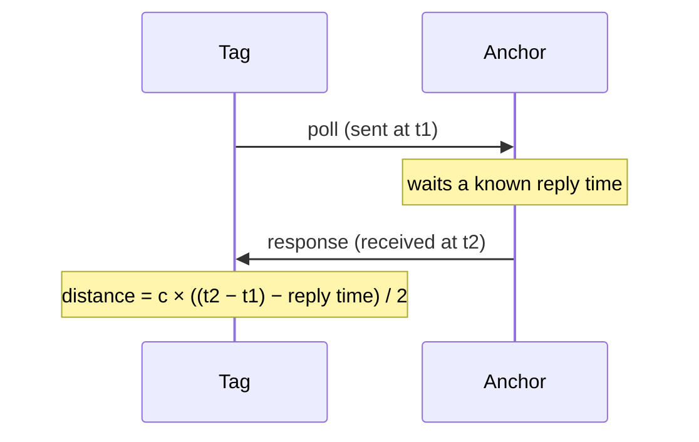
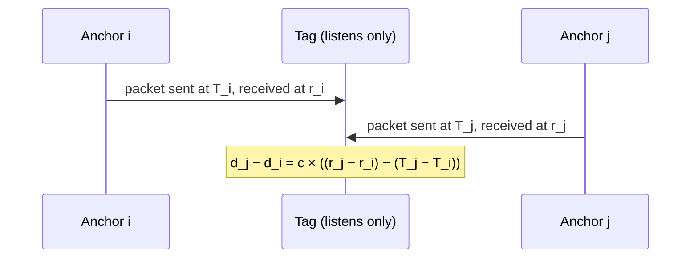

# UWB basics

A short introduction to ultra-wideband (UWB) ranging for readers new to it. For how the simulator models these measurements, see the [measurement model](measurement_model.md).

## How UWB measures distance

UWB radios send very short pulses, under a nanosecond long, spread over a wide band [1]. In the United States, a transmitter counts as UWB when its bandwidth is at least 500 MHz, or at least 20 % of its centre frequency [2]. A short pulse gives a sharp arrival time, so the receiver can timestamp it precisely. Distance comes from the **time of flight**: radio travels at the speed of light, about 30 cm per nanosecond [3], and the widely used Decawave DW1000 chip timestamps in steps of about 15.65 ps, which is about 5 mm [4].

Two kinds of node take part, and the same hardware can usually play either role [5]:

- **Anchors** are the reference nodes.
- **Tags** are the nodes being located.

**Strengths**
- **Accurate:** UWB systems typically reach 10-20 cm [1]. With the hardware calibrated here, ranging noise is about 12 cm for Eliko [6] and about 5 cm for UTIL's static data [7]. Signal-strength methods such as Wi-Fi RSSI are typically off by metres, with 2.94 m median error reported for one well-known Wi-Fi system [1].
- **Works indoors:** the very short pulses make it less sensitive to multipath [1], and it works in GNSS-denied places [8].
- **Independent of light:** it works in low visibility, and needs far less computation than camera-based tracking [8].
- **Low power** [1], and low-cost modules exist [9].

**Weaknesses**
- **Obstacles bias it.** Without line of sight (NLOS), the signal is delayed and degraded [9]. In UTIL's static tests, a blocked link reads long, by up to 35 cm behind metal, the largest of the materials tested [7]. Moving obstacles such as people cause errors that don't stay consistent [9].
- **It needs anchors,** installed at known positions or carried by robots [8].
- **Short range** compared with other radios [1]. Eliko's datasheet gives about 75 m [6].
- **Hardware-dependent errors:** antenna delays and the relative orientation of the two antennas add biases that need calibrating [9], [10].
- **Shared channel:** devices take turns, so the more devices actively ranging, the lower each one's update rate (see TWR below) [5].

## Ranging modes

### Two-way ranging (TWR)

The tag and an anchor exchange messages and measure the **round trip**, so their clocks don't need to be synchronised [8]:

Each exchange gives **one distance per anchor-tag pair**. The two clocks run at slightly different rates, which adds an error during the reply time, so practical systems add a third message (double-sided TWR) to reduce it [11]. The tag actively ranges with each anchor in turn, so adding tags adds load: in Bitcraze's Loco Positioning System, TWR positions only one tag at a time [5].

Eliko's systems use a variant called **active-passive TWR (AP-TWR)** [15]. According to Eliko, it adds passive anchors and handovers between anchors, so any number of anchors can take part in ranging. Unlike standard TWR, adding anchors doesn't reduce the number of tags or their update rate, and it still needs no anchor synchronisation, which Eliko says keeps it more robust than TDoA. Eliko also describes its precision as better than standard TWR and TDoA, but publishes no figures for that.

### Time difference of arrival (TDoA)

The anchors keep a common timebase, by synchronising [8] or by tracking each other's clock drift [12]. From arrival times at two nodes, the system gets a **difference of distances**, $`d_j - d_i`$, rather than a distance. Each difference places the tag on a hyperboloid [1], so locating it in 3D takes at least four anchors: three independent differences for three unknown coordinates.

In downlink TDoA, for example, each anchor sends a packet whose transmit time on the common timebase is known, and the tag timestamps its arrival:

Each arrival time is the transmit time plus the time of flight, $`r = T + d/c`$, so subtracting the two cancels the tag's own clock offset and leaves the difference of distances. Figure 3 of the UTIL paper [9] shows the full packet timing between a tag and two anchors, each with its own clock.

There are two variants:

- **Downlink:** the anchors transmit and the tag only listens, as in the Loco Positioning System and the UTIL dataset [5], [9]. New tags add no load, so any number of tags can be used [5].
- **Uplink:** the tag transmits short "blinks", and synchronised anchors timestamp them for a central location engine [13].

Accuracy depends on the anchors' timing, and is best inside the volume the anchors surround [5], [12]. Differences that share a reference anchor share that anchor's error, so they're correlated.

## Setups

**Fixed anchors, tags on robots.** Anchors are mounted at known, surveyed positions [8], [9], and robots carry tags. This gives **absolute** positions in the anchor frame, and works best inside the space the anchors surround [5]. The area has to be equipped beforehand.

**Anchors and tags on robots.** Several UWB nodes are carried on each robot, for example anchors on a ground vehicle and tags on a drone, which gives **relative** positions between robots with no infrastructure [8]. The anchors can only be as far apart as the robot is large, which limits accuracy [8], so the ranges are usually combined with other sensors such as odometry [14].

The simulator supports both, and mixes of them: any robot can carry tags, anchors or both, and anchors can also be fixed in the world (see [Layout files](advanced_setup.md#layout-files)).

## References

1. F. Zafari, A. Gkelias, K. K. Leung, "A Survey of Indoor Localization Systems and Technologies", *IEEE Communications Surveys & Tutorials*, 2019. Sections II-F, III-E, III-F and VI-A. https://arxiv.org/abs/1709.01015
2. 47 CFR § 15.503, *Definitions* (UWB bandwidth and UWB transmitter). https://www.law.cornell.edu/cfr/text/47/15.503
3. NIST, *Speed of light in vacuum* (CODATA): exactly 299 792 458 m/s. https://physics.nist.gov/cgi-bin/cuu/Value?c
4. Decawave, *DW1000 User Manual*: system time counted at 499.2 MHz × 128, about 15.65 ps per tick. As quoted in this DW1000 driver: https://os.mbed.com/users/AndyA/code/DW1000/file/0b408e77b701/DW1000.h
5. Bitcraze, *Loco Positioning System* documentation (TWR, TDoA 2 and TDoA 3; anchor placement). https://www.bitcraze.io/documentation/system/positioning/loco-positioning-system/
6. A. Martínez-Silva, D. Alejo, L. Merino, F. Caballero, "UWBPX4Sim: Ultra-Wideband simulator for multi-robot applications", Robot Meets Ranging workshop, ICRA 2026. Section II-B and Table II.
7. This repository's [measurement model](measurement_model.md), Calibration: static data, Figure 2 (UTIL identification dataset).
8. W. Shule, C. M. Almansa, J. Peña Queralta, Z. Zou, T. Westerlund, "UWB-Based Localization for Multi-UAV Systems and Collaborative Heterogeneous Multi-Robot Systems: a Survey", 2020. Sections I, II-A, II-B, III and IV. https://arxiv.org/abs/2004.08174
9. W. Zhao, A. Goudar, X. Qiao, A. P. Schoellig, "UTIL: An Ultra-wideband Time-difference-of-arrival Indoor Localization Dataset", *IJRR*, 2024. https://arxiv.org/abs/2203.14471
10. M. A. Shalaby, C. C. Cossette, J. R. Forbes, J. Le Ny, "Calibration and Uncertainty Characterization for Ultra-Wideband Two-Way-Ranging Measurements", ICRA 2023 (antenna-delay calibration). https://arxiv.org/abs/2210.05888
11. Decawave, *APS011 Application Note: Sources of Error in DW1000 Based Two-Way Ranging (TWR) Schemes* (two-way ranging with clock drift; double-sided TWR). https://www.qorvo.com/products/d/da008446
12. Bitcraze, *TDoA principles*, lps-node-firmware documentation. https://www.bitcraze.io/documentation/repository/lps-node-firmware/master/functional-areas/tdoa_principles/
13. A. Acton, V. Kulkarni (ARIN Technologies), "Scalable, Low-Cost Indoor Localization System using TDoA and UWB", Microsoft Indoor Localization Competition. https://www.microsoft.com/en-us/research/wp-content/uploads/2016/11/ARINTech_Acton.pdf
14. A. Martínez-Silva, D. Alejo, L. Merino, F. Caballero, "Radio-based Multi-Robot Odometry and Relative Localization", 2025. https://arxiv.org/abs/2509.26558
15. Eliko, *UWB RTLS: Ultra-Wideband Real-Time Location System* (comparison of AP-TWR, TWR and TDoA; vendor claims). https://eliko.tech/uwb-rtls-ultra-wideband-real-time-location-system/
