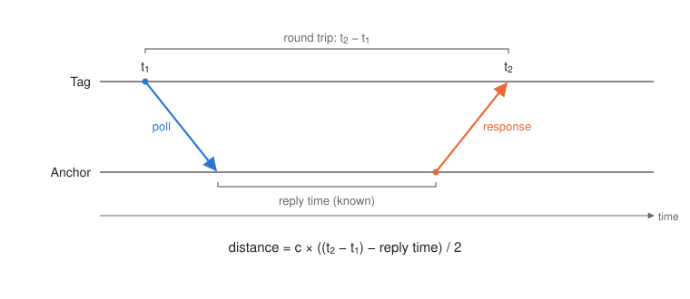
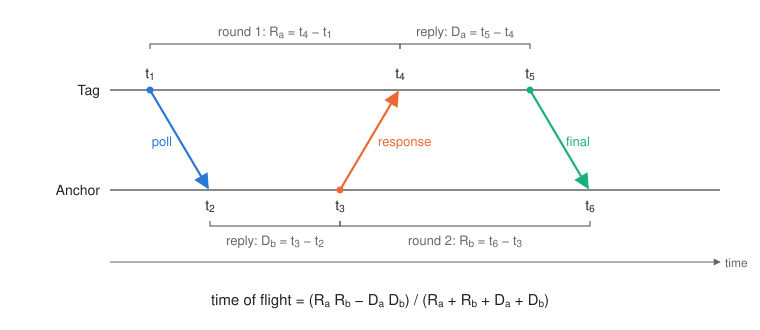
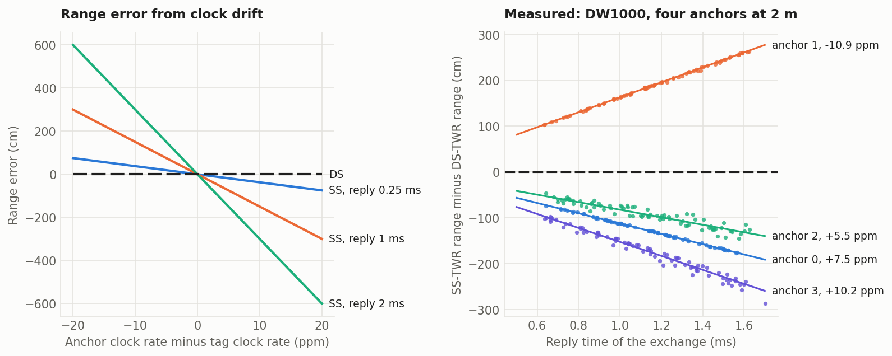
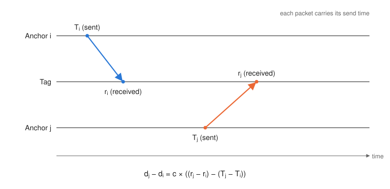
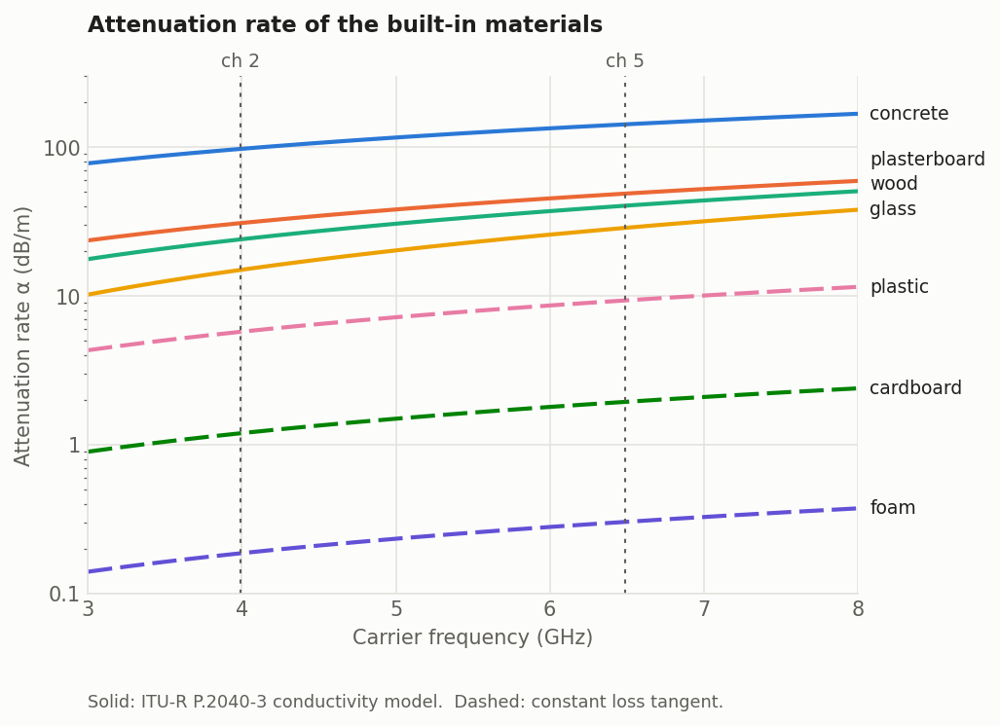

# UWB basics

A short introduction to ultra-wideband (UWB) ranging for readers new to it. For how the simulator models these measurements, see the [measurement model](measurement_model.md).

## How UWB measures distance

UWB radios send very short pulses, under a nanosecond long, spread over a wide band [1]. In the United States, a transmitter counts as UWB when its bandwidth is at least 500 MHz, or at least 20 % of its centre frequency [2]. A short pulse gives a sharp arrival time, so the receiver can timestamp it precisely. Distance comes from the **time of flight**: radio travels at the speed of light, about 30 cm per nanosecond [3], and the widely used Decawave DW1000 chip timestamps in steps of about 15.65 ps, which is about 5 mm [4].

Two kinds of node take part, and the same hardware can usually play either role [5]:

- **Anchors** are the reference nodes.
- **Tags** are the nodes being located.

**Strengths**
- **Accurate:** UWB systems typically reach 10-20 cm [1]. With the hardware calibrated here, ranging noise is about 12 cm for Eliko [6] and about 5 cm for UTIL's static data [7]. Signal-strength methods such as Wi-Fi RSSI are typically off by metres, with 2.94 m median error reported for one well-known Wi-Fi system [1].
- **Works indoors:** the very short pulses make it less sensitive to multipath [1], and it works in GNSS-denied places [8].
- **Independent of light:** it works in low visibility, and needs far less computation than camera-based tracking [8].
- **Low power** [1], and low-cost modules exist [9].

**Weaknesses**
- **Obstacles bias it.** Without line of sight (NLOS), the signal is delayed and degraded [9]. In UTIL's static tests, a blocked link reads long, by up to 35 cm behind metal, the largest of the materials tested [7]. Moving obstacles such as people cause errors that don't stay consistent [9].
- **It needs anchors,** installed at known positions or carried by robots [8].
- **Short range** compared with other radios [1]. Eliko's datasheet gives about 75 m [6].
- **Hardware-dependent errors:** antenna delays and the relative orientation of the two antennas add biases that need calibrating [9], [10].
- **Shared channel:** devices take turns, so the more devices actively ranging, the lower each one's update rate (see TWR below) [5].

## Ranging modes

### Two-way ranging (TWR)

The tag and an anchor exchange messages and measure the **round trip**, so their clocks don't need to be synchronised [8] (Figure 1):



*Figure 1: Two-way ranging. Time runs left to right; each arrow is a message, and its slope is the time of flight.*

Each exchange gives **one distance per anchor-tag pair**. The two clocks run at slightly different rates, which adds an error during the reply time (see [Single-sided and double-sided TWR](#single-sided-and-double-sided-twr)). The tag actively ranges with each anchor in turn, so adding tags adds load: in Bitcraze's Loco Positioning System, TWR positions only one tag at a time [5].

Eliko's systems use a variant called **active-passive TWR (AP-TWR)** [15]. According to Eliko, it adds passive anchors and handovers between anchors, so any number of anchors can take part in ranging. Unlike standard TWR, adding anchors doesn't reduce the number of tags or their update rate, and it still needs no anchor synchronisation, which Eliko says keeps it more robust than TDoA. Eliko also describes its precision as better than standard TWR and TDoA, but publishes no figures for that.

#### Single-sided and double-sided TWR

**Single-sided TWR (SS-TWR)** is the two-message exchange of Figure 1. The tag times the round trip on its own clock, the anchor times its reply on its own clock, and the difference is twice the time of flight. But each device counts time with its own crystal, and two crystals never run at exactly the same rate: they typically differ by a few parts per million (ppm) [11]. The reply is long compared with the flight, about a millisecond against tens of nanoseconds, so a tiny rate difference over the reply becomes a large range error: half the drift times the reply time, times $`c`$. For example, 10 ppm over a 1 ms reply is 1.5 m (Figure 3, left) [11].

**Double-sided TWR (DS-TWR)** adds a third message (Figure 2). Now each side measures one round trip and one reply on its own clock. Combining the four intervals with the asymmetric formula of Neirynck et al. [19] cancels the drift without needing the two replies to be equal. What remains is about the drift times the time of flight, under 0.01 cm. The cost is a third message for every range: more airtime and more energy.



*Figure 2: Double-sided two-way ranging, drawn like Figure 1. The tag measures round 1 and its reply, the anchor measures its reply and round 2, each on its own clock.*

Figure 3 (right) shows this on real data: a DW1000 tag ranging to four anchors at 2 m, all standing still [20]. The firmware's reply time varies between exchanges (0.6-1.7 ms), and the SS-TWR range moves with it along a straight line set by each anchor's drift, from -10.9 to +10.2 ppm, up to 2.9 m off. DS-TWR, computed from the same exchanges, stays put.



*Figure 3: Range error from clock drift. Left: SS-TWR at three reply times, and DS-TWR. Right: SS-TWR range minus DS-TWR range for each exchange of a DW1000 tag at 2 m from four anchors [20]; the lines are the formula with each anchor's measured drift.*

SS-TWR can still be accurate if the drift is measured some other way and corrected, for example from the timestamps of many exchanges when nothing moves. That is how the DW3000 ranges behind the simulator's `dw3000_twr` preset were recovered (see [Calibration](measurement_model.md#dw3000-twr-preset-dw3000_twr)). The simulator itself doesn't simulate the messages: it models the resulting range error, as measured on real hardware.

### Time difference of arrival (TDoA)

The anchors keep a common timebase, by synchronising [8] or by tracking each other's clock drift [12]. From arrival times at two nodes, the system gets a **difference of distances**, $`d_j - d_i`$, rather than a distance. Each difference places the tag on a hyperboloid [1], so locating it in 3D takes at least four anchors: three independent differences for three unknown coordinates.

In downlink TDoA, for example, each anchor sends a packet whose transmit time on the common timebase is known, and the tag timestamps its arrival (Figure 4):



*Figure 4: Downlink TDoA, drawn like Figure 1. The tag only listens.*

Each arrival time is the transmit time plus the time of flight, $`r = T + d/c`$, so subtracting the two cancels the tag's own clock offset and leaves the difference of distances. Figure 3 of the UTIL paper [9] shows the full packet timing between a tag and two anchors, each with its own clock.

There are two variants:

- **Downlink:** the anchors transmit and the tag only listens, as in the Loco Positioning System and the UTIL dataset [5], [9]. New tags add no load, so any number of tags can be used [5].
- **Uplink:** the tag transmits short "blinks", and synchronised anchors timestamp them for a central location engine [13].

Accuracy depends on the anchors' timing, and is best inside the volume the anchors surround [5], [12]. Differences that share a reference anchor share that anchor's error, so they're correlated.

## Signals through obstacles

When a wall or an object blocks the direct path (NLOS), the signal goes through it and loses power on the way. How much it loses depends on the material, how thick it is and the carrier frequency.

**Attenuation rate.** Inside a material, the signal's power falls exponentially with distance, so its loss in decibels grows linearly with thickness: crossing $`\ell`$ metres costs $`\alpha \ell`$ dB, where $`\alpha`$ is the material's **attenuation rate** in dB/m [16]. Two properties of the material set it:

- **Relative permittivity** $`\varepsilon_r`$: how strongly the material responds to the field. It also slows the wave to $`c/\sqrt{\varepsilon_r}`$ [16], [17].
- **Loss tangent** $`\tan\delta`$: how much of the wave's energy the material turns into heat on each cycle. Some sources give the conductivity $`\sigma`$ instead, which is equivalent: $`\sigma = 2\pi f \varepsilon_0 \varepsilon_r \tan\delta`$ [16].

For materials that let most of the signal through ($`\tan\delta < 0.5`$, which includes common building materials [16]), the rate is approximately [16], [17]

```math
\alpha \approx 91\, f\, \sqrt{\varepsilon_r}\, \tan\delta \ \text{dB/m}, \qquad f \text{ in GHz}.
```

The loss tangent has by far the stronger effect: $`\alpha`$ is proportional to it, but only to the square root of $`\varepsilon_r`$.

**Carrier frequency.** The frequency appears in the formula directly: with a constant loss tangent, $`\alpha`$ grows in proportion to $`f`$. Real materials aren't quite that simple. ITU-R P.2040 models the conductivity of concrete, plasterboard, wood and glass as $`\sigma = c f^{d}`$, with $`d`$ between about 0.8 and 1.3 depending on the material, so their rates grow roughly as $`f^{d}`$ [16]. Either way, higher channels lose more. The DW1000 offers, among others, channel 2 at about 4 GHz and channel 5 at about 6.5 GHz [18]. Moving from channel 2 to channel 5 raises the rate of the simulator's built-in materials by a factor of 1.5 to 1.9 (Figure 5). A 20 cm concrete wall, for example, costs about 20 dB on channel 2 and about 29 dB on channel 5. 20 dB is as much as moving from 1 m to 10 m away in free space, where power falls with the square of distance.



*Figure 5: Attenuation rate of the simulator's built-in materials against carrier frequency, on a logarithmic scale. Solid lines follow ITU-R P.2040-3's conductivity model [16], dashed lines a constant loss tangent.*

**Metal** is a conductor, not a dielectric: the field dies out within micrometres. For a conductivity of $`10^7`$ S/m, ITU-R P.2040's conductor formula gives about 3.5 dB per micrometre at 4 GHz [16]. Practically nothing goes through, so whatever signal arrives has gone around the obstacle or reflected off other surfaces.

In the simulator, obstacles are tagged with a material, and the loss through them sets the noise, dropouts and bias of the link. See the [Material table](measurement_model.md#material-table) for the built-in materials, [Custom materials](measurement_model.md#custom-materials) to add your own from $`\varepsilon_r`$ and $`\tan\delta`$, and the [link budget](measurement_model.md#link-budget) for how metal is handled.

## Setups

**Fixed anchors, tags on robots.** Anchors are mounted at known, surveyed positions [8], [9], and robots carry tags. This gives **absolute** positions in the anchor frame, and works best inside the space the anchors surround [5]. The area has to be equipped beforehand.

**Anchors and tags on robots.** Several UWB nodes are carried on each robot, for example anchors on a ground vehicle and tags on a drone, which gives **relative** positions between robots with no infrastructure [8]. The anchors can only be as far apart as the robot is large, which limits accuracy [8], so the ranges are usually combined with other sensors such as odometry [14].

The simulator supports both, and mixes of them: any robot can carry tags, anchors or both, and anchors can also be fixed in the world (see [Layout files](advanced_setup.md#layout-files)).

## References

1. F. Zafari, A. Gkelias, K. K. Leung, "A Survey of Indoor Localization Systems and Technologies", *IEEE Communications Surveys & Tutorials*, 2019. Sections II-F, III-E, III-F and VI-A. https://arxiv.org/abs/1709.01015
2. 47 CFR § 15.503, *Definitions* (UWB bandwidth and UWB transmitter). https://www.law.cornell.edu/cfr/text/47/15.503
3. NIST, *Speed of light in vacuum* (CODATA): exactly 299 792 458 m/s. https://physics.nist.gov/cgi-bin/cuu/Value?c
4. Decawave, *DW1000 User Manual*: system time counted at 499.2 MHz × 128, about 15.65 ps per tick. As quoted in this DW1000 driver: https://os.mbed.com/users/AndyA/code/DW1000/file/0b408e77b701/DW1000.h
5. Bitcraze, *Loco Positioning System* documentation (TWR, TDoA 2 and TDoA 3; anchor placement). https://www.bitcraze.io/documentation/system/positioning/loco-positioning-system/
6. A. Martínez-Silva, D. Alejo, L. Merino, F. Caballero, "UWBPX4Sim: Ultra-Wideband simulator for multi-robot applications", Robot Meets Ranging workshop, ICRA 2026. Section II-B and Table II.
7. This repository's [measurement model](measurement_model.md), Calibration: static data, Figure 2 (UTIL identification dataset).
8. W. Shule, C. M. Almansa, J. Peña Queralta, Z. Zou, T. Westerlund, "UWB-Based Localization for Multi-UAV Systems and Collaborative Heterogeneous Multi-Robot Systems: a Survey", 2020. Sections I, II-A, II-B, III and IV. https://arxiv.org/abs/2004.08174
9. W. Zhao, A. Goudar, X. Qiao, A. P. Schoellig, "UTIL: An Ultra-wideband Time-difference-of-arrival Indoor Localization Dataset", *IJRR*, 2024. https://arxiv.org/abs/2203.14471
10. M. A. Shalaby, C. C. Cossette, J. R. Forbes, J. Le Ny, "Calibration and Uncertainty Characterization for Ultra-Wideband Two-Way-Ranging Measurements", ICRA 2023 (antenna-delay calibration). https://arxiv.org/abs/2210.05888
11. Decawave, *APS011 Application Note: Sources of Error in DW1000 Based Two-Way Ranging (TWR) Schemes* (two-way ranging with clock drift; double-sided TWR). https://www.qorvo.com/products/d/da008446
12. Bitcraze, *TDoA principles*, lps-node-firmware documentation. https://www.bitcraze.io/documentation/repository/lps-node-firmware/master/functional-areas/tdoa_principles/
13. A. Acton, V. Kulkarni (ARIN Technologies), "Scalable, Low-Cost Indoor Localization System using TDoA and UWB", Microsoft Indoor Localization Competition. https://www.microsoft.com/en-us/research/wp-content/uploads/2016/11/ARINTech_Acton.pdf
14. A. Martínez-Silva, D. Alejo, L. Merino, F. Caballero, "Radio-based Multi-Robot Odometry and Relative Localization", *IEEE ICRA*, 2026, pp. 17557–17564. https://doi.org/10.1109/ICRA57385.2026.11696767
15. Eliko, *UWB RTLS: Ultra-Wideband Real-Time Location System* (comparison of AP-TWR, TWR and TDoA; vendor claims). https://eliko.tech/uwb-rtls-ultra-wideband-real-time-location-system/
16. ITU-R Recommendation P.2040-3, *Effects of building materials and structures on radiowave propagation above about 100 MHz*, 2023. Section 2 (attenuation rate of dielectrics and conductors, conductivity and loss tangent) and Table 3 (material coefficients). https://www.itu.int/rec/R-REC-P.2040/en
17. D. M. Pozar, *Microwave Engineering*, 4th ed., Wiley, 2012. Chapter 1 (plane waves in lossy media, low-loss dielectrics).
18. IEEE Std 802.15.4-2020, *IEEE Standard for Low-Rate Wireless Networks*, HRP UWB PHY channel plan (channel 2: 3993.6 MHz; channel 5: 6489.6 MHz).
19. D. Neirynck, E. Luk, M. McLaughlin, "An alternative double-sided two-way ranging method", *13th Workshop on Positioning, Navigation and Communications (WPNC)*, 2016. https://doi.org/10.1109/WPNC.2016.7822844
20. J. C. Santamaria-Pedrón, R. Berkvens, C. Reaño, J. J. Pérez-Solano, J. Torres-Sospedra, "Reproducible package for 'Performance evaluation of UWB in indoor environments: CIR and coverage analysis'", Zenodo, 2026 (calibration_anchors, DW1000). https://doi.org/10.5281/zenodo.21099647
